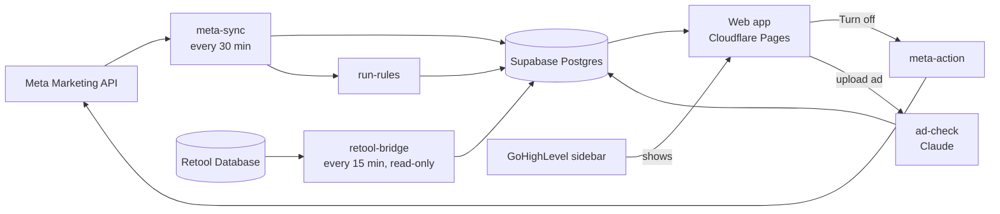

# Architecture

How the platform is put together. For *why*, see [decisions.md](decisions.md). For the plan and phases, see [plan.md](plan.md).

## The pieces

| Piece | Where | What it does |
|---|---|---|
| **Web app** | `web/`, hosted on Cloudflare Pages | Everything people see. Reads data, never computes it from APIs directly. |
| **Database** | Supabase Postgres, `supabase/migrations/` | All data, reporting functions, security rules. |
| **Background jobs** | Supabase Edge Functions, `supabase/functions/` | Meta sync, Retool bridge, suggestion runs, "Turn off" action, AI ad check. |
| **Shared logic** | `shared/` | KPI formulas, date presets, suggestion rules, Meta mapping. Used by both the app and the jobs, so they always agree. |

## How a screen gets its numbers

1. The screen asks the **DataSource** (`web/src/data/source.ts`) for, say, `report('ad', range)`.
2. In production the DataSource calls the database function `report()` (`supabase/migrations/…0600_reporting.sql`). That function returns **raw totals** (spend, leads, clicks…) per ad for the date range, already filtered to Active/New clients.
3. The screen turns raw totals into KPIs with `shared/domain/metrics.ts` (CPL = spend ÷ leads, etc.).

Raw totals come from the database. Derived numbers come from **one** TypeScript file. That's what keeps the dashboard, the CSV export and the suggestion rules consistent.

## Sample data mode

If `web/.env.local` has no Supabase URL/key, the app uses `web/src/data/mockSource.ts` instead. It generates fictional gyms and 75 days of numbers in the browser, from a fixed seed so everyone sees the same thing. It applies the **same rules** as the SQL `report()` function, so screens behave identically when real data arrives. A yellow banner says "Sample data" whenever this mode is on.

The sample data deliberately includes the situations suggestions look for: a budget-hog ad, expensive leads, spend with no leads, low CTR, an unsettled account and a disabled account.

## Live updates

Live since 10 Nov 2026 (migration 1800, `web/src/lib/useLiveRefresh.ts`). Open screens subscribe to `sync_runs` through Supabase Realtime and reload when a job finishes: Insights after a Meta sync or Retool copy, Suggestions after `run-rules`, Sync status after any job. Screens also reload when a tab comes back after being hidden for 5+ minutes. The table stays on screen while it reloads. Row-level security applies to the events too.

## New versions

Each build gets an id (`vite.config.ts`) written into the app and `/version.json`. An open page checks every 5 minutes and when the tab comes back; if a newer version is live it shows **"The Lab was updated. Reload"** (`web/src/app/UpdateBanner.tsx`), so nobody keeps using an outdated copy.

## Security in one paragraph

The browser only ever holds the public "anon" key plus the signed-in user's session. **Row-level security** in the database decides what each person can read or write ([auth.md](auth.md)). API tokens (Meta, GHL, Claude, the Retool DB connection) live only in Supabase secrets and are used only by background jobs. Nothing secret is in the repo or the browser.

## Phone and desktop

One app, responsive. Tailwind's `md:` breakpoint (768px) switches between:
- **Phone:** stacked cards, tap "More" for every metric, bottom tab bar.
- **Desktop:** full sortable tables, top navigation.

Inside GHL the app is shown in the sidebar (custom menu link / marketplace app page). On phones, staff use the direct link and can add it to their home screen.

## Conventions

- TypeScript everywhere, `strict` on.
- Shared code (`shared/`) has **no** dependencies on React, Supabase or Node, so it runs in the browser, in Deno (Edge Functions) and in tests. Imports inside `shared/` use explicit `.ts` extensions for Deno.
- All dates are calendar days in **America/Toronto**, inclusive ranges, `YYYY-MM-DD` strings (`shared/domain/dates.ts`).
- Money is shown in the account's currency units. Totals across mixed USD/CAD accounts are added as-is, the same as Retool ([metrics.md](metrics.md#known-limitations)).
