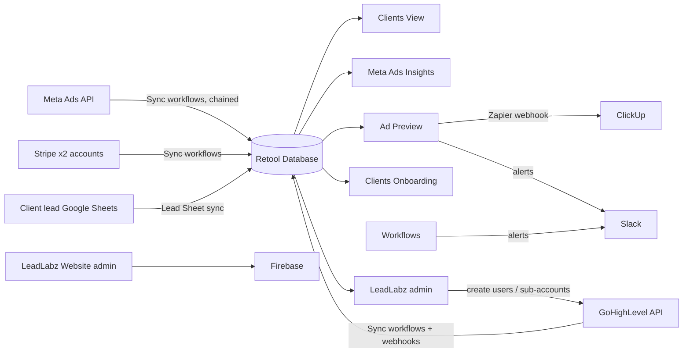

# Current system: what MRKD runs on Retool today

This is an inventory of the Retool setup we are replacing, built from a full export taken on 8 Nov 2026 (47 apps, 32 workflows, the Retool Database schema). It is the "before" picture. Every feature here is accounted for in [plan.md](plan.md), either rebuilt, replaced, or deliberately dropped.

---

## 1. The big picture

Retool is doing four jobs at once:

1. **A data warehouse.** Background workflows copy data from Meta, GoHighLevel (GHL), Stripe and Google Sheets into the Retool Database.
2. **A reporting tool.** Clients View and Meta Ads Insights read that data and show it to ads managers.
3. **An operations tool.** Onboarding, ad preview/approval, ad and lead-form templates.
4. **A GHL / LeadLabz admin panel.** Creating sub-accounts, managing users and permissions, custom fields and values, and the LeadLabz website users.

---

## 2. Live apps (the "MRKD Internal Tools" folder)

| App | What it does | Talks to |
|---|---|---|
| **Clients View** | Main daily dashboard. Each client with leads, booked, shown and closed counts, new members, upfront cash, MRR generated, Meta spend, ad account status, Stripe billing (MRKD and LeadLabz), last and next billed date, unread GHL messages. Filters by ads manager, active status, LeadLabz clients and client ID. "Show alerts" highlights rows red or yellow. Can bulk-update client status in GHL. | Retool DB, GHL API (live conversation counts per location), sync workflows |
| **Meta Ads Insights** | Performance drill-down: account → campaign → ad set → ad, with period-over-period comparison, lead stats by ad name, creative previews, filter by ads manager. | Retool DB, Meta sync workflows |
| **Ad Preview 🤖** | Ad approval pipeline. Pick a client, build the ad creative and lead form from templates plus the client's business info, then move it draft → review → changes requested → completed. Comments, Slack alerts at each step, a ClickUp card through a Zapier webhook, and AI review that checks the uploaded ad image against the client's business data. | Retool DB, GHL, Slack, Zapier→ClickUp, Retool AI |
| **Clients Onboarding** | Onboarding form per client: gym details, instructors, programs, kids program, pricing, offers, area callouts, marked-area images, and up to 2 "campaign specifics" (ad type, monthly budget plus upper limit, CTA, landing page, booking link, lead flow, CRM). Pushes changes back to the client's contact in GHL. | Retool DB, GHL |
| **Meta Ad Components Templates** | Create and edit reusable ad creative and lead form templates (CTA, questions, form type). | Retool DB |
| **Search Meta Lead Forms** | Free-text search across all synced lead forms and ad copy. | Retool DB |
| **LeadLabz ⚙️** | GHL admin. MRKD contacts and custom fields, assigning client IDs, creating sub-accounts from a snapshot, users and permission templates, location custom values and a custom value mapping config. | Retool DB, GHL API |
| **Leadlabz (Website) ⚙️** | Admin for the LeadLabz website. Firebase users (create, reset password), which businesses and ad accounts each user can see, subscription plan config, onboarding flags. | Retool DB, Firebase |

### Supporting / dev apps worth keeping ideas from
- **Ad Ai Analyzer**, **Ad Copy Generator**: AI ad copy built from client data, booking types and GHL calendar availability, then a ClickUp task.
- **Go High Level**: bulk edit custom fields and values.
- **Leadlabz calendar embed**: generates embeddable booking calendar HTML from GHL calendars.
- **Stripe Subscriptions Dash**: subscriptions, plans and invoices view.
- **Test view multi creatives**: creative analysis table (feeds `creative_analysis`).
- **MRKD Mobile**: early Retool Mobile attempt.

### Not worth migrating (about 25 apps)
Copies and old versions (`Clients View - copy` ×3, `Meta Ads Insights - copy` ×2, `(Test)`, `Multipage`), Retool samples (`customer success dashboard`, `Example app`, `Marketing Campaign Dashboard`, `Stripe Checkout`), empty or blank apps (`Untitled-*`, `Test App`, `Trent Forrest - Jan 25`, `Reporting UI` shell), and experiments (`AI Chat`, `[Dev] AI testing App`, `A2P Registration Guide` sandbox, `Facebook Ads Api`, `Onboarding Page`, `testing`).

Two **Retool Forms** could not be exported: *Leadlabz Onboarding form* and *Untitled (1)*. We need screenshots of these.

---

## 3. Workflows (background jobs)

| Group | Workflows | Notes |
|---|---|---|
| **Scheduler** | `Crons - 1.0` | One master workflow reads the `cron_jobs` table and fires the next step. Meta syncs are **chained**: ad accounts → campaigns → ad sets → ads → creatives → insights → leads. Each step only runs **30–300 minutes after the previous one**, so a full Meta refresh can take hours. It also processes GHL custom-value mapping jobs. |
| **Meta Ads** | Sync Ad Accounts, Campaigns, Adset, Ads, Ad Creative, Single Ad Creative, Ads Insights, Ad Account Analytics, Leads, Pages & Leadform, Leadform Fetch | Pulls everything into `meta_*` tables. Uses Graph API **v20.0** (hard-coded). Slack alerts on failure. |
| **GHL** | Create Subaccounts For Contact, Sync All Locations Data, Sync All Location Contacts, Sync Single Contact (webhook), GHL Refresh Access token, DELETE CONTACTS (DO NOT TRIGGER) | Creating a sub-account: read the client's contact → create a GHL location from a snapshot → get a location token → write the location ID back to the contact → Slack the assigned ads manager. |
| **Clients & Leads** | Sync All Clients from GHL contacts, Sync Lead Sheet / (All Clients) / (Failed Clients) | `clients` is built from contacts in MRKD's own GHL location. **Lead outcomes (booked, shown, closed, membership value) come from each client's Google Sheet**, read through Google Sheets and transformed in Python into `leads`. |
| **Stripe** | Customer, Subscription and Invoice Sync | Two Stripe accounts: **MRKD Marketing** and **LeadLabz**. Polled, not webhooks. |
| **Tests** | 7 test/demo workflows | Drop. *Update Conversations From GHL API 2.0* had its last 10 runs fail. |

> ⚠️ Every workflow in the export shows `isEnabled: false` and no crontab. That may just be how Retool exports them, but **confirm which ones are actually running today** before cutover.

---

## 4. Database (Retool Database / Postgres)

Approximate row counts come from Postgres statistics and can read 0 for tables that do have data.

### Core business tables
| Table | Rows | Purpose / key columns |
|---|---|---|
| `clients` | 221 | `id`, `business_name`, `contact_id` → `ghl_contacts`, `location_id` (client's GHL sub-account), `active_status` (New / Active / Inactive / Paused), lead-sync status |
| `employees` | – | `id` (GHL user ID), name, email, `is_ad_manager`, `slack_id`, `active` |
| `leads` | 63,203 | One row per lead from the client's Google Sheet: date added, contact info, appointment status, closed value, monthly membership value, first payment date, date left, campaign/ad set/ad name |
| `campaign_specifics` | – | Per-client campaign setup: ad type, monthly budget plus upper limit, CTA, landing page, booking link, lead flow, CRM details |
| `campaign_onboarding_info` | – | Gym, instructor, program, pricing and offer details for ad copy |
| `ads_preview` | 594 | Ad approval items: JSON metadata (creative and lead form), step, status, comments, AI response, review timestamps |
| `ad_creative_templates`, `leadform_templates` | – | Reusable templates (JSON) |
| `creative_analysis` | – | AI analysis per Meta creative (model, cost, prompt, JSON result) |
| `configs` | – | Key/value JSON config: editable custom fields, user-permission templates, custom value mapping |

### Meta (synced)
`meta_ad_accounts` (188, with `client_id`), `meta_campaigns` (7.9k), `meta_adsets` (10.7k), `meta_ads` (20k), `meta_ad_creatives` (21k), `meta_ad_insights` (124k, daily per ad, mostly JSON), `meta_ad_account_insights` (26.5k, daily per account: spend, impressions, clicks, reach, CTR, CPC, actions), `meta_leads` (36.7k), `meta_leadgen_forms` (2.3k), `meta_pages` (155)

### GHL (synced)
`ghl_contacts` (1.2k; contacts in MRKD's agency location = clients and prospects, with onboarding/contract/payment flags), `ghl_locations` (75; sub-accounts, agency and snapshots, **including an access token per location**), `ghl_access_token` (agency OAuth token and refresh token)

### Stripe (synced)
`stripe_customers` (413, typed MRKD Marketing / LeadLabz, linked to `client_id`), `stripe_subscriptions` (235), `stripe_invoices` (3.6k)

### LeadLabz website
`website_users`, `website_user_contacts`, `website_campaign_requests`, `website_configs`, `leadlabzCalendar`

### Lookup lists (`enum_*`)
Ad types (jiu jitsu beginners/kids, yoga studio, kickboxing, boutique fitness, …), booking types, CTA options, campaign objectives, client statuses, GHL location types, lead form options, offer types, Stripe customer types, genders, placements.

### Leftovers to drop
`ads_preview_copy`, `mobile_app_sample_data`, `gpt_chat_sessions`, `gpt_chat_messages`, the Retool vector table, and the views `custom_values_metadata_view` / `full_metadata_view`. One view is hard-coded to a single location.

---

## 5. How "which ads manager owns which client" works today

There is **no `ad_manager` column** in the database. Clients View works it out on page load:

1. Read the client's contact from MRKD's GHL location (`ghl_contacts.metadata`).
2. Decode its custom fields and take the **`assigned_to`** value, a GHL user ID.
3. Match it to `employees.id`.

So **GHL's "Assigned to" field on the client contact is the source of truth** for groupings. The new system keeps that, but stores it as a real column, synced, so filtering is instant.

---

## 6. Existing alert rules (Clients View "Show alerts")

- 🔴 Active/New client with a lead sheet, but **0 leads in the last 3 days**
- 🔴 **Unread messages** from the client (contact or location)
- 🔴 Active client **not billed in 14+ days**
- 🟡 LeadLabz location active but **no active LeadLabz subscription**
- Icons for ad account disabled or not

These carry over as the first set of rules in the new suggestions engine.

---

## 7. Problems found in the current setup

1. **Slow, fragile refresh.** Meta syncs are chained through a cron table with 30–300 minute gaps, so data can be hours old. One failure stalls the chain.
2. **Heavy work at page load.** Clients View calls GHL live for every location (two calls each) and decodes custom fields in the browser on every visit. This is slow and breaks when one token is bad ("Invalid JWT").
3. **Secrets stored as plain table columns.** GHL access and refresh tokens sit in `ghl_locations` and `ghl_access_token`, readable by every app and every builder.
4. **Hard-coded IDs** throughout: MRKD location ID, company ID, custom field IDs, Graph API version.
5. **Search queries are built by string concatenation** (Search Meta Lead Forms), which risks SQL injection.
6. **No real relationships** between Meta tables (no foreign keys), and most metrics are buried in JSON. Reporting queries are long and slow as a result.
7. **App sprawl.** 47 apps, about 25 of them copies, tests or samples. It isn't clear which version is live.
8. **No audit trail** for actions (status changes, bulk GHL updates, sub-account creation).
9. **Duplicate time-zone logic.** Toronto time is hand-rolled in many queries, some with `- interval '4 hour'`, which drifts with daylight saving.
