# Design options: pick one

Four looks for the same app. **Same screens, same data; only the style changes.** Pick one (or mix: "B's colours with C's sidebar") and the others get removed.

**Try them live:** run the app (`npm run dev`) and use **Design** in the yellow bar at the top, or add `?design=classic` / `midnight` / `bold` / `compact` to any URL. Your choice is remembered on that browser.

| | Look | Best for |
|---|---|---|
| **A · Classic** | Black top bar, white cards, blue links | Familiar and clean; closest to a modern Retool |
| **B · Midnight** | Dark dashboard, green accents, glowing numbers | Screens left open all day; easy on the eyes |
| **C · MRKD Bold** | Black left sidebar, warm cream background, orange buttons, big Space Grotesk numbers | Feels like an MRKD product rather than a tool |
| **D · Compact** | Smaller text, tighter rows, square corners, slate top bar | Fitting the most rows and columns on screen, like Retool today |

Phones get a bottom tab bar in every design.

## A · Classic

| Desktop | Phone |
|---|---|
| 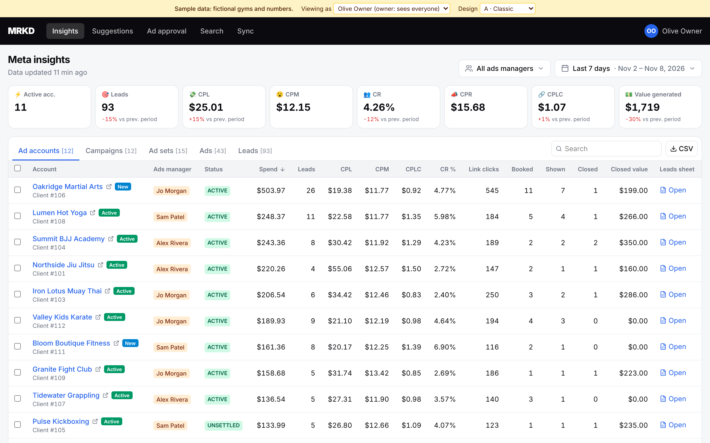 | 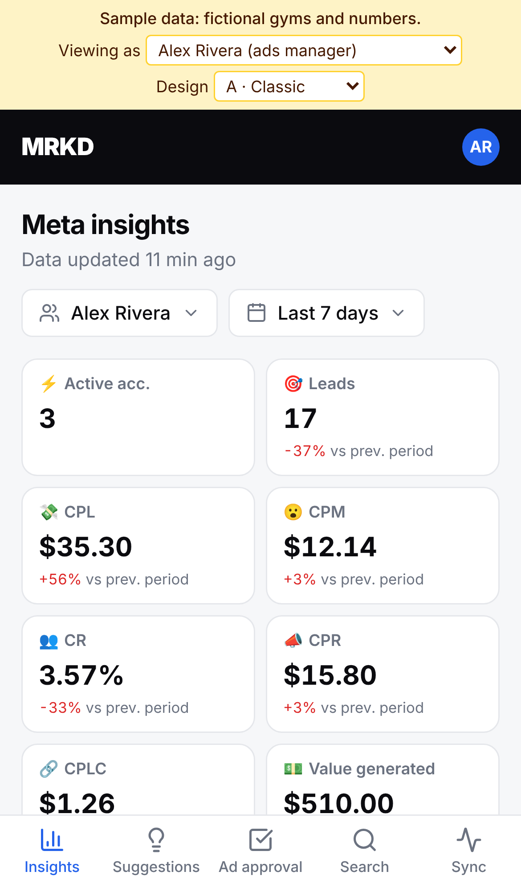 |
| 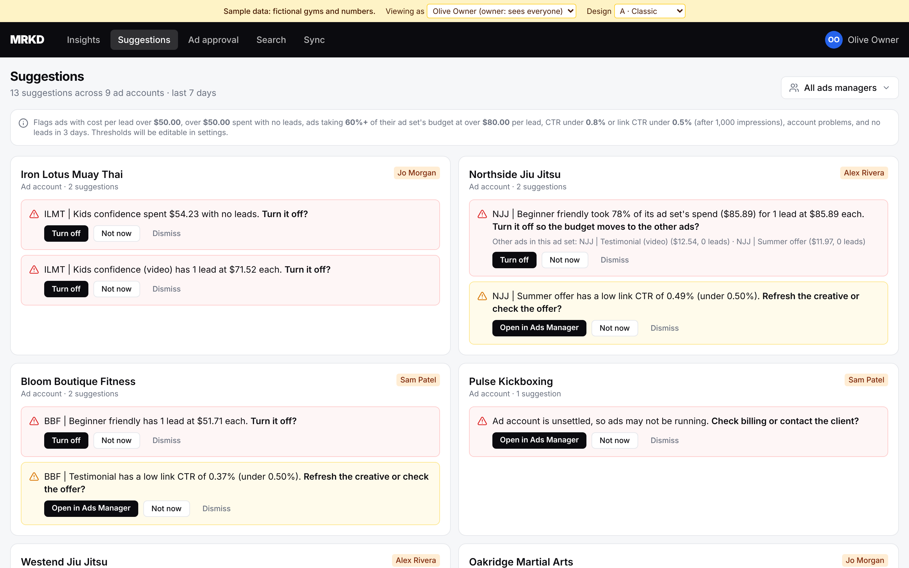 | 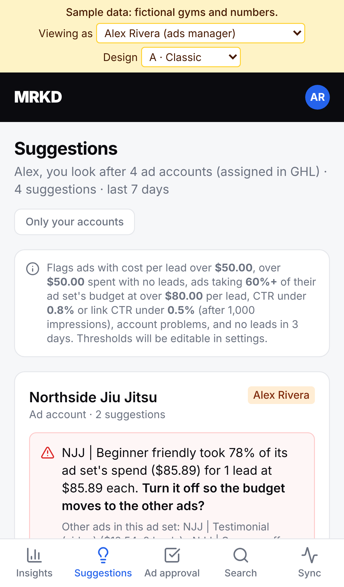 |

## B · Midnight

| Desktop | Phone |
|---|---|
| 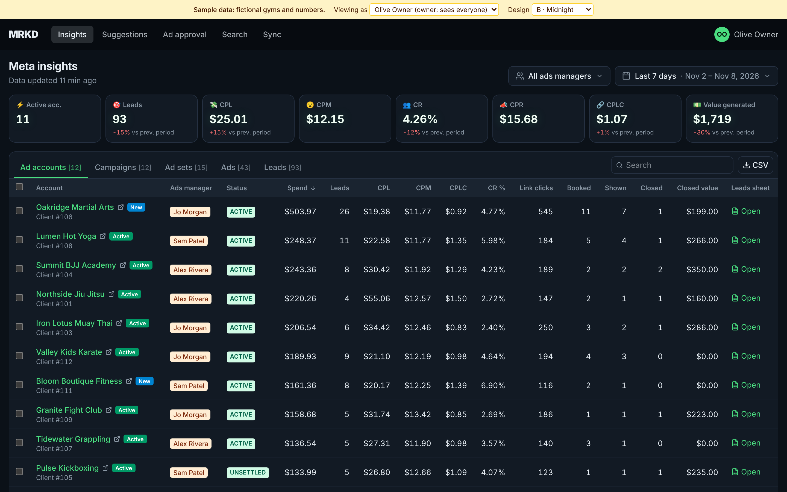 | 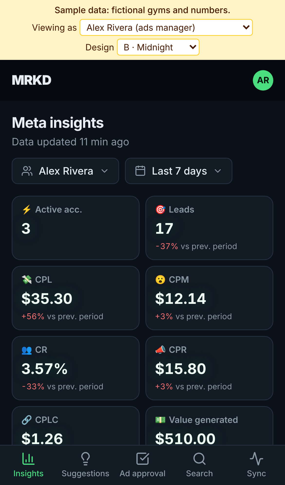 |
| 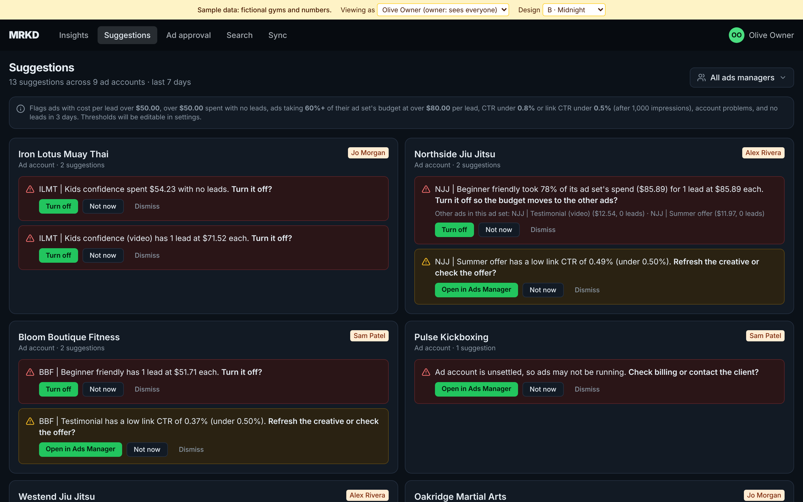 | 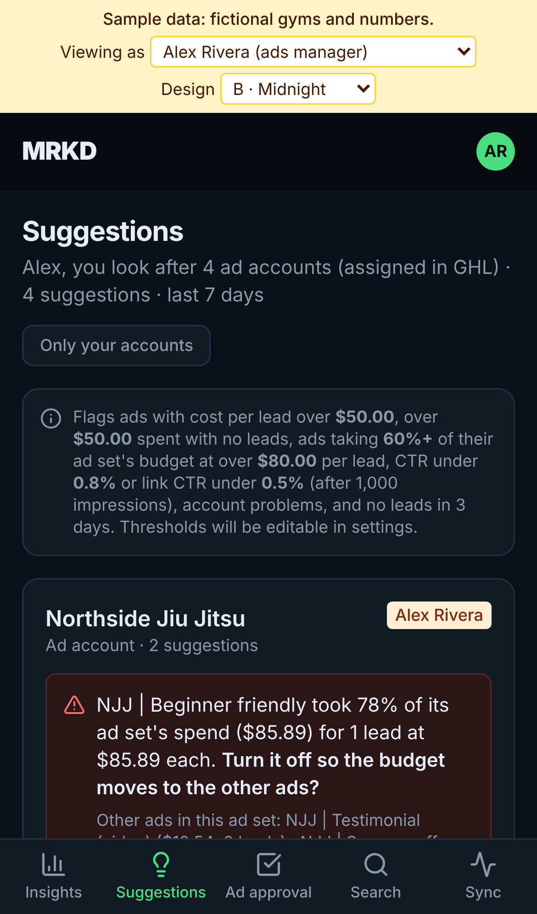 |

## C · MRKD Bold

| Desktop | Phone |
|---|---|
| 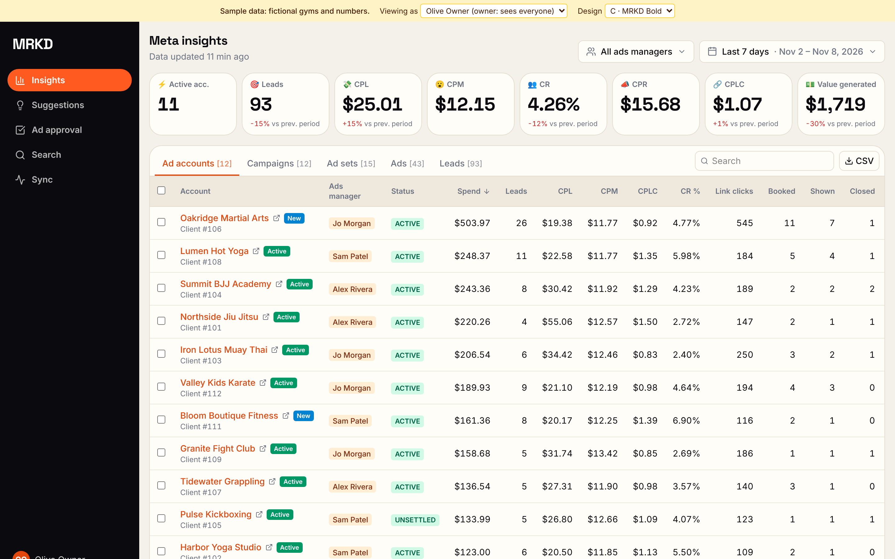 | 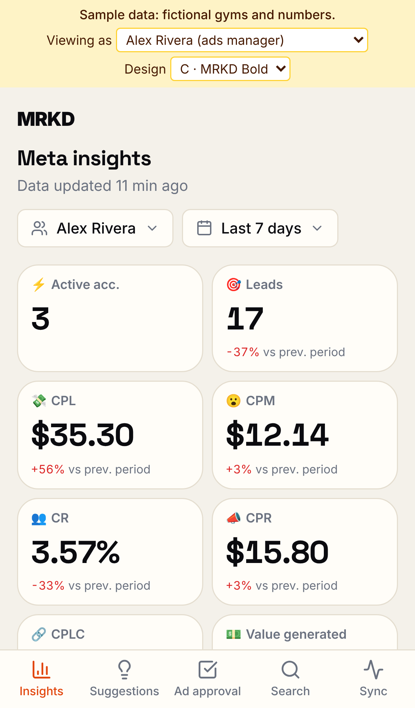 |
| 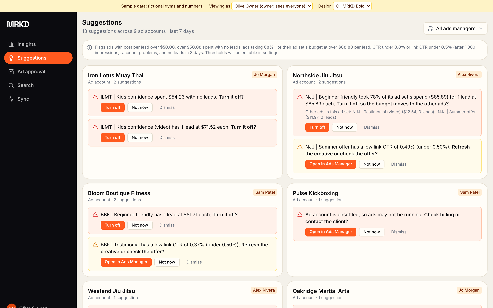 | 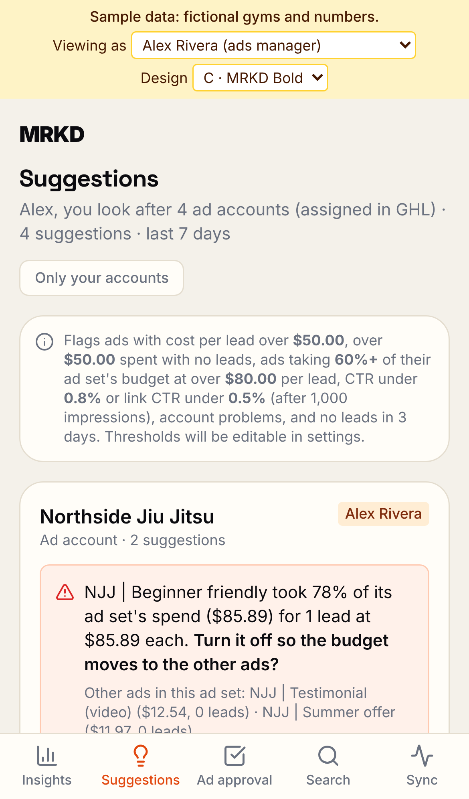 |

## D · Compact

| Desktop | Phone |
|---|---|
| 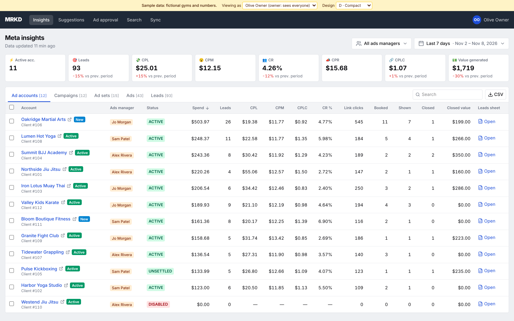 | 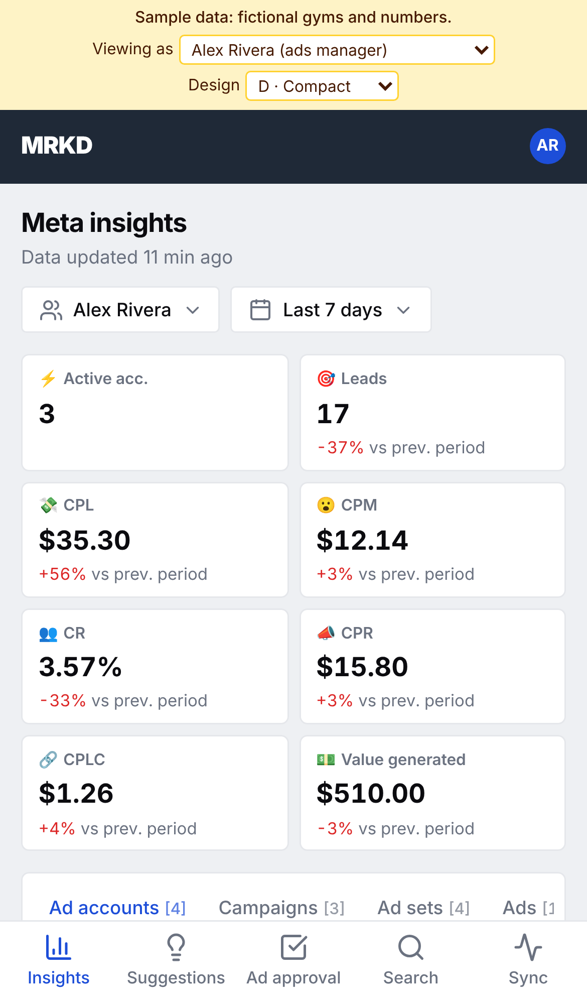 |
| 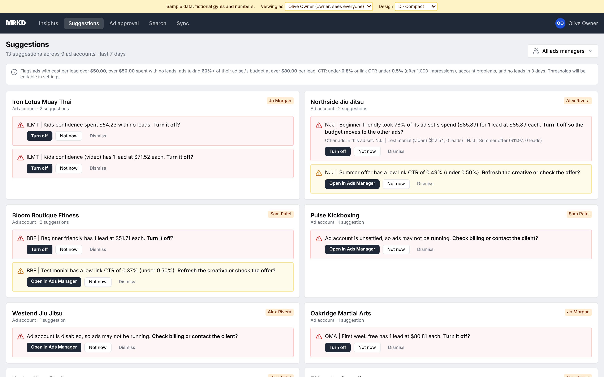 | 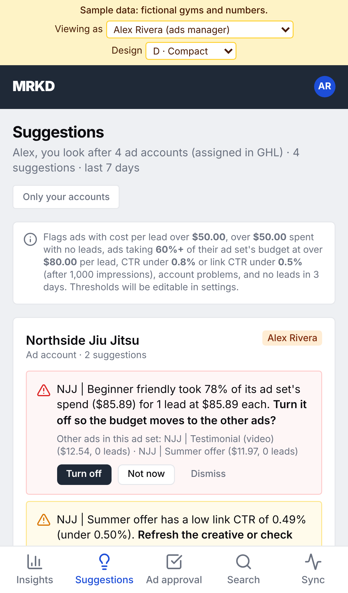 |

*Desktop shots are "viewing as" an owner (sees every account); phone shots are "viewing as" ads manager Alex, so Suggestions shows only his accounts.*

## How it's built

Every colour, font and corner radius is a named setting ("design token") in [`web/src/index.css`](../web/src/index.css): `surface`, `canvas`, `ink`, `brand`, `primary`, `alert-high`… Components only use those names, so each design is just a block of values. Design C also swaps the top bar for a sidebar (`web/src/app/Layout.tsx`). Fonts (Inter, Space Grotesk) are bundled with the app, so there are no Google Fonts requests and it works inside GHL.

Once a design is picked: keep its values as the defaults, delete the other blocks and the switcher, and update this page.
