# Design options

**Chosen, 11 Nov 2026: G · Air, with light and dark mode.** Everyone sees Air by default. Dark mode: the sun / moon button next to your name (on phones, top right), or **Settings → Look → Light or dark** (Light, Dark, or Match device, which follows the phone or computer setting; Match device is the default). The other looks stay selectable in Settings for now and can be removed once everyone is happy with Air.

### G · Air, dark mode

| Insights | Suggestions |
|---|---|
|  |  |
|  |  |

Light mode screenshots are under [G · Air](#g--air) below.

---

The options that were considered:

Four looks for the same app. **Same screens, same data; only the style changes.** Pick one (or mix: "B's colours with C's sidebar") and the others get removed.

**Try them live:** run the app (`npm run dev`) and use **Design** in the yellow bar at the top, or add `?design=classic` / `midnight` / `bold` / `compact` to any URL. Your choice is remembered on that browser.

| | Look | Best for |
|---|---|---|
| **A · Classic** | Black top bar, white cards, blue links | Familiar and clean; closest to a modern Retool |
| **B · Midnight** | Dark dashboard, green accents, glowing numbers | Screens left open all day; easy on the eyes |
| **C · MRKD Bold** | Black left sidebar, warm cream background, orange buttons, big Space Grotesk numbers | Feels like an MRKD product rather than a tool |
| **D · Compact** | Smaller text, tighter rows, square corners, slate top bar | Fitting the most rows and columns on screen, like Retool today |

Phones get a bottom tab bar in every design.

## Applies to every design

Simple and organised: plain text labels, no emojis, line icons only in navigation and buttons, consistent spacing.

## A · Classic

| Desktop | Phone |
|---|---|
|  |  |
|  |  |

## B · Midnight

| Desktop | Phone |
|---|---|
|  |  |
|  |  |

## C · MRKD Bold

| Desktop | Phone |
|---|---|
|  |  |
|  |  |

## D · Compact

| Desktop | Phone |
|---|---|
|  |  |
|  |  |

*Desktop shots are "viewing as" an owner (sees every account); phone shots are "viewing as" ads manager Alex, so Suggestions shows only his accounts.*

## Sleeker options

Added 11 Nov 2026 after Jordan asked for "something a bit sleeker". Jordan picked **G · Air** the same day and asked for a dark mode for it (above). To try one on real data: **Settings → Look → Sleeker options** (changes only your browser), or add `?design=graphite` / `onyx` / `air` / `studio` to any link.

What they share: thinner borders, softer shadows instead of heavy outlines, tighter headings, quieter chips (the ads-manager name and client status are grey instead of coloured; only problems stay coloured), and Inter's cleaner letter shapes.

| | Look | Feels like |
|---|---|---|
| **E · Graphite** | White top bar with a hairline under it, near-white page, soft card shadows, indigo accent, black buttons | Linear / Notion: quiet, professional |
| **F · Onyx** | True black, white buttons, blue accent, translucent status colours | Vercel dark: sharp, great at night |
| **G · Air** | White sidebar, pale grey page, rounded cards, teal buttons | Calm and roomy; easiest to read for long stretches |
| **H · Studio** | Charcoal sidebar, crisp white content, MRKD orange only on main buttons, Space Grotesk numbers | MRKD's own look, but cleaner than C · Bold |

### E · Graphite

| Insights | Suggestions |
|---|---|
| 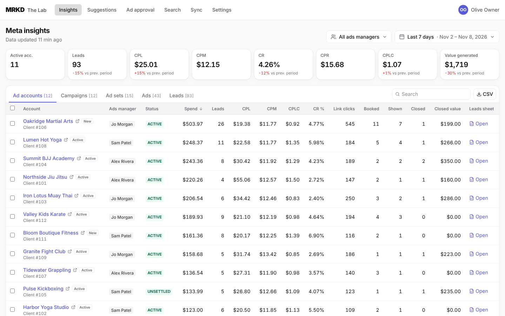 | 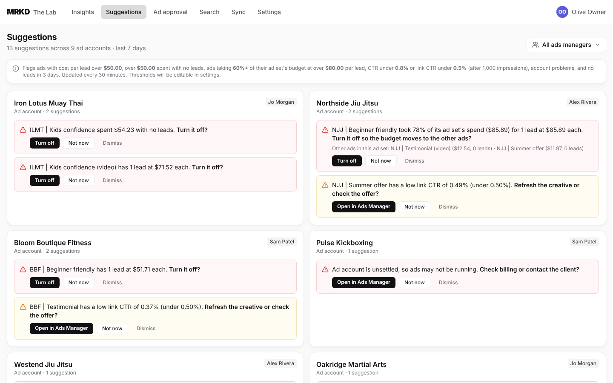 |
| 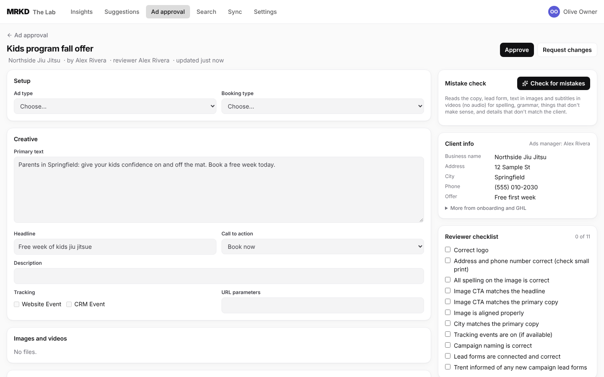 | 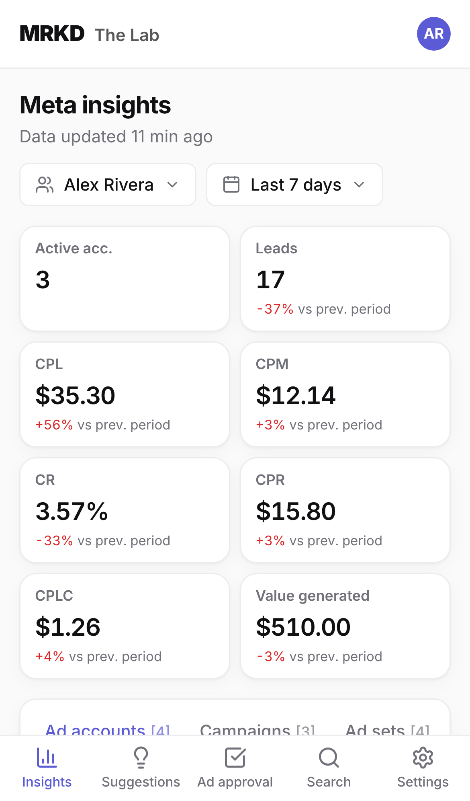 |

### F · Onyx

| Insights | Suggestions |
|---|---|
| 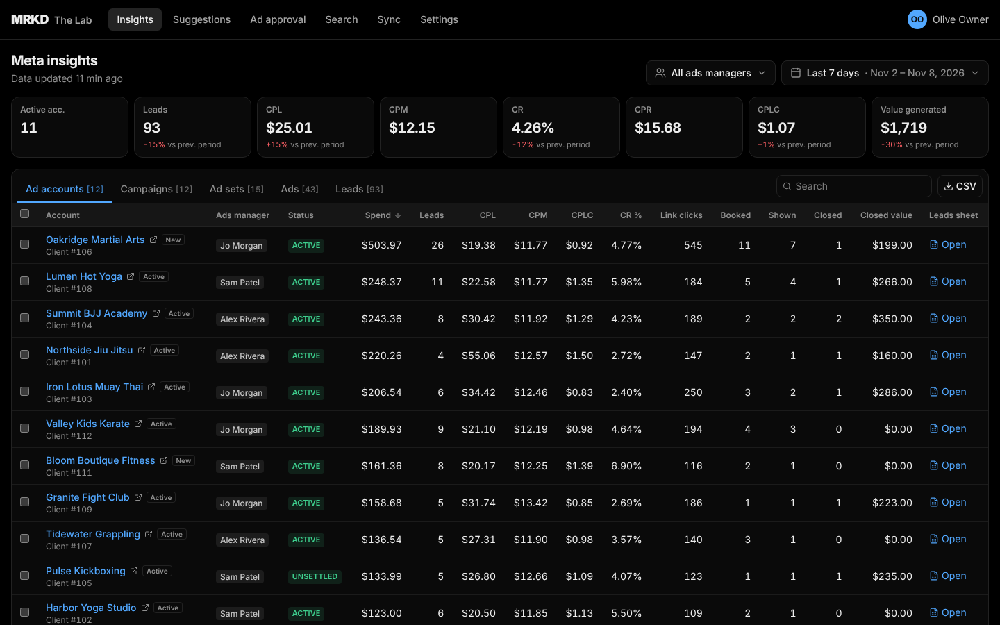 | 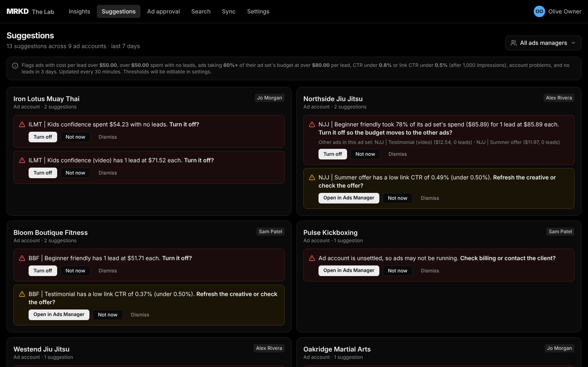 |
| 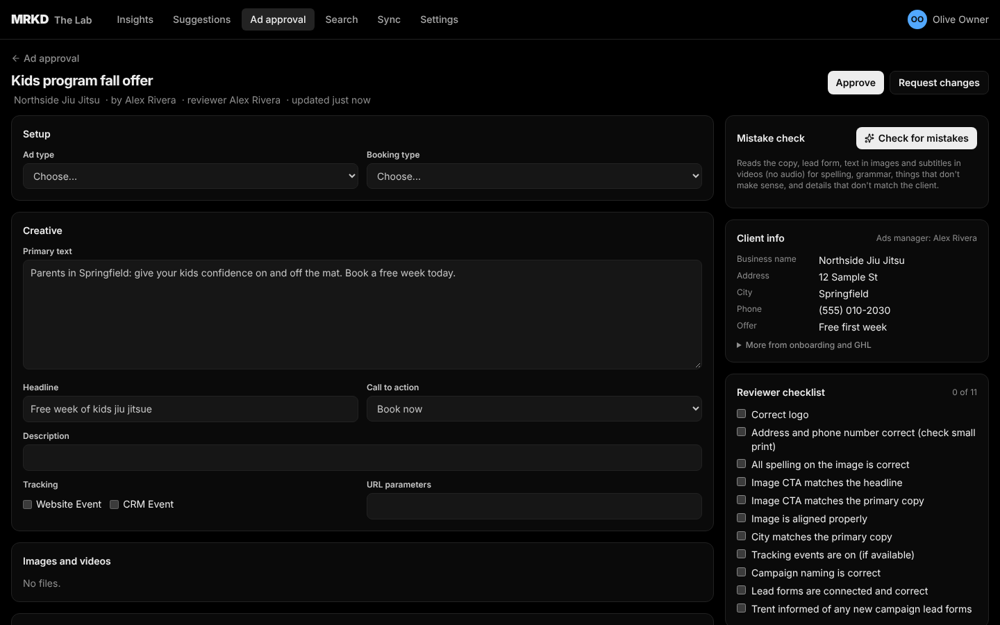 | 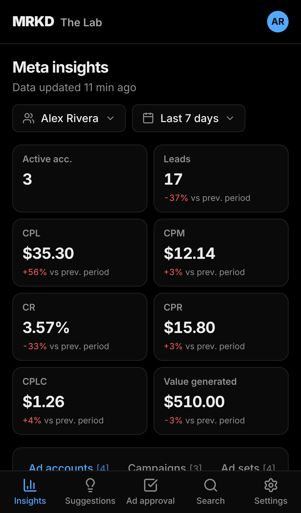 |

### G · Air

| Insights | Suggestions |
|---|---|
| 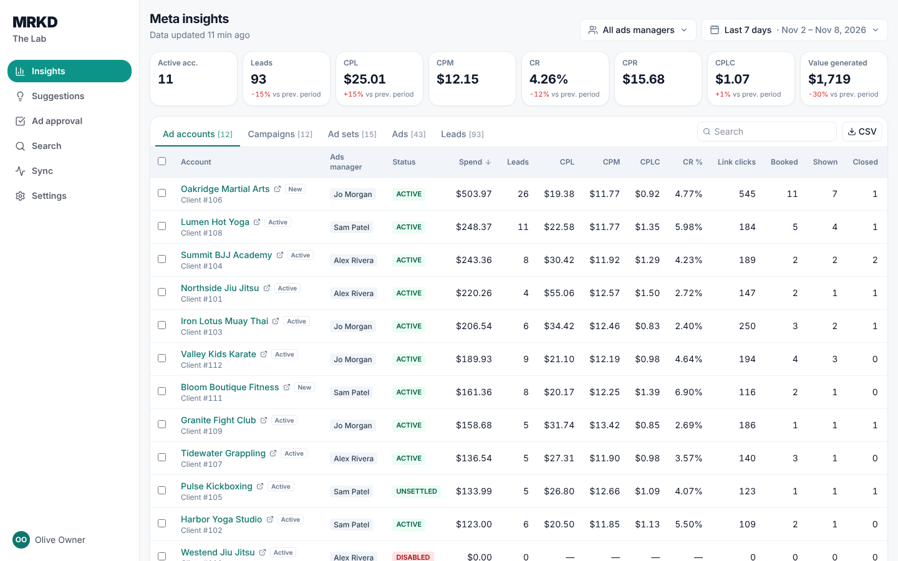 | 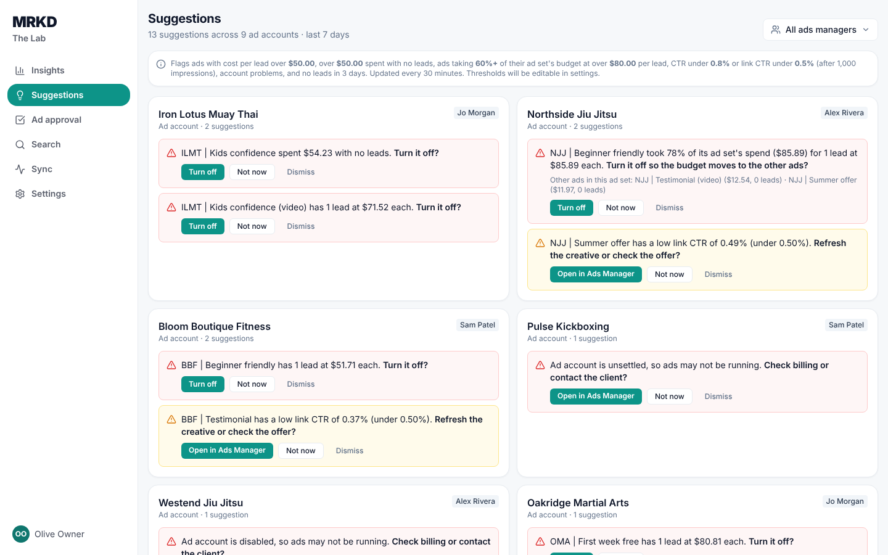 |
| 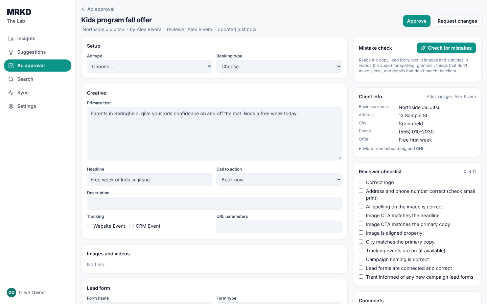 | 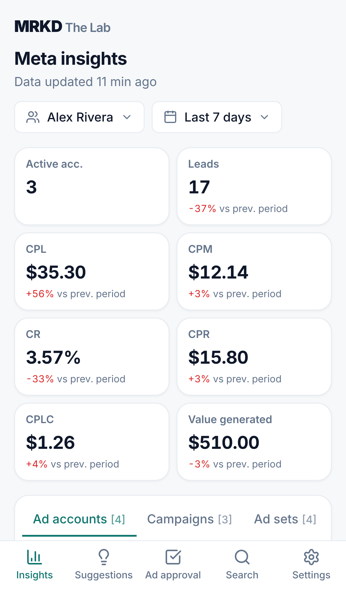 |

### H · Studio

| Insights | Suggestions |
|---|---|
| 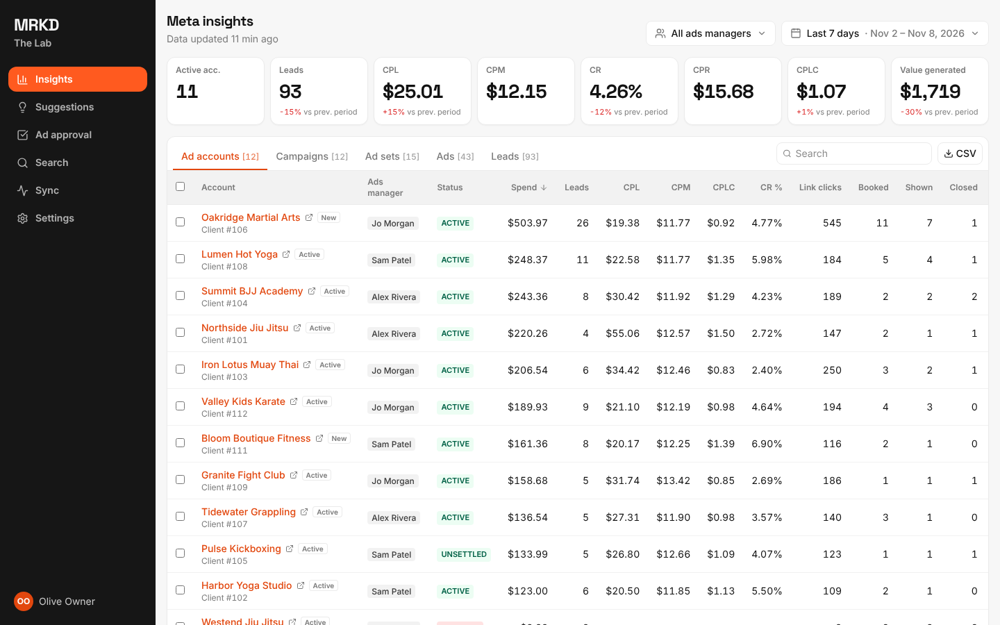 | 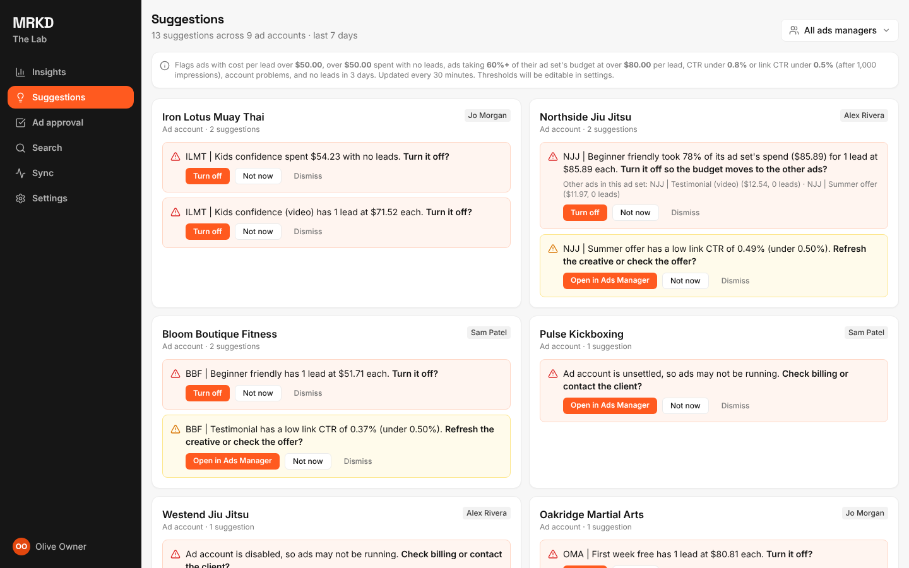 |
| 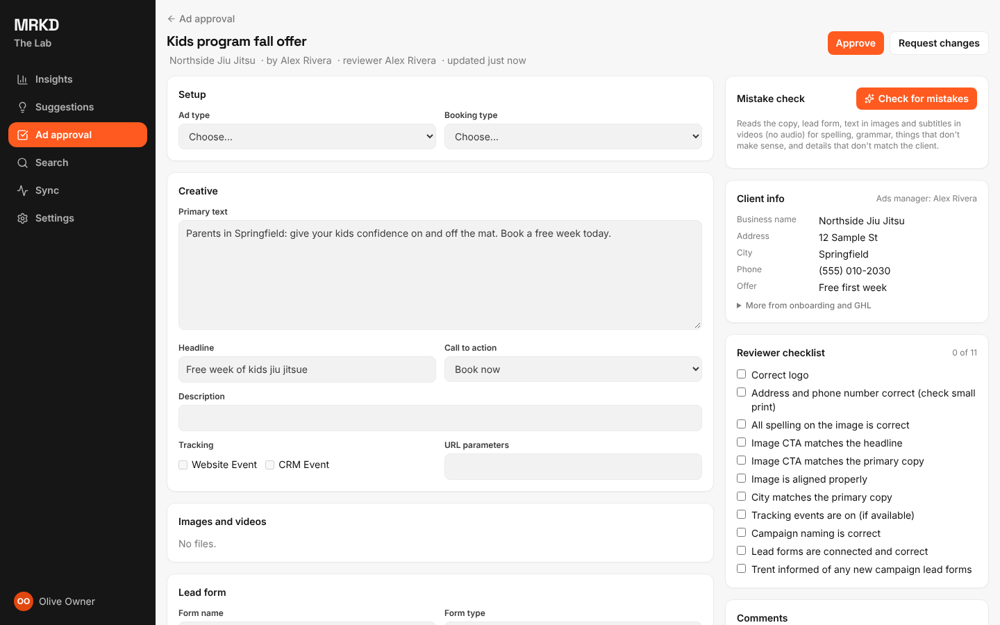 | 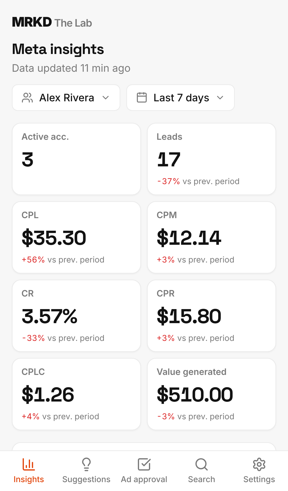 |

*Screenshots use sample data (fictional gyms). Desktop: viewing as an owner. Phone: viewing as ads manager Alex.*

## How it's built

Every colour, font and corner radius is a named setting ("design token") in [`web/src/index.css`](../web/src/index.css): `surface`, `canvas`, `ink`, `brand`, `primary`, `alert-high`… Components only use those names, so each design is just a block of values. Designs C, G and H use a left sidebar instead of the top bar (`SIDEBAR_DESIGNS` in `web/src/app/Layout.tsx`). The sleeker options also quieten a few fixed chip colours at the end of `index.css`. Fonts (Inter, Space Grotesk) are bundled with the app, so there are no Google Fonts requests and it works inside GHL.

Light / dark: `data-mode` on the page (`light` or `dark`), set from the saved choice by a small script in `web/index.html` before the page draws (so there's no flash of the wrong look, including on the sign-in screen) and kept up to date by `web/src/app/session.tsx`. Air's dark values are the `[data-design="air"][data-mode="dark"]` block in `index.css`. Choices are remembered per browser (`mrkd.design.v2`, `mrkd.mode`).

Removing the unused looks later: delete their blocks in `index.css`, their entries in `DESIGNS`, and the Look list in Settings, then update this page.
