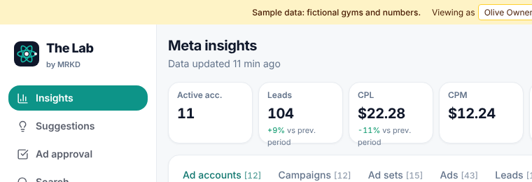
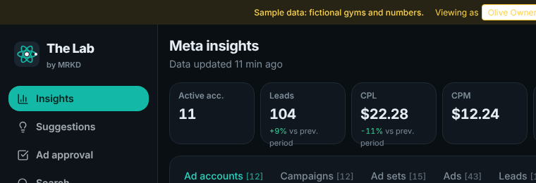
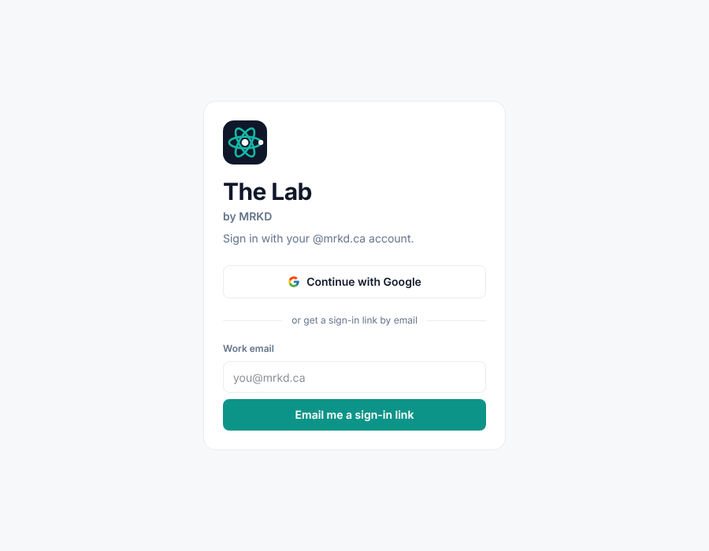
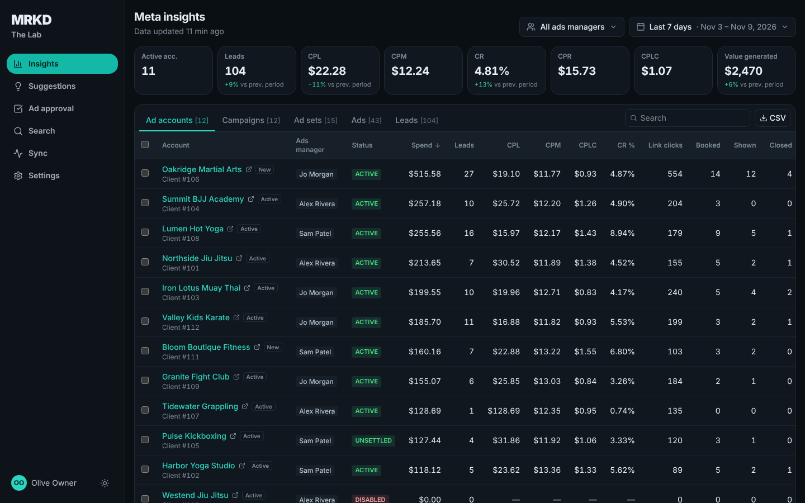
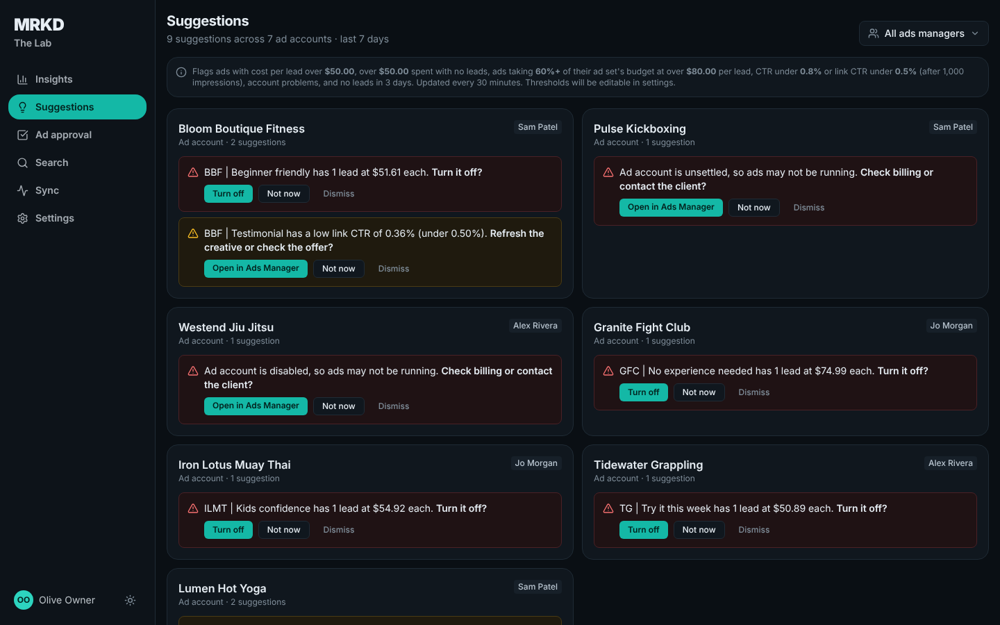
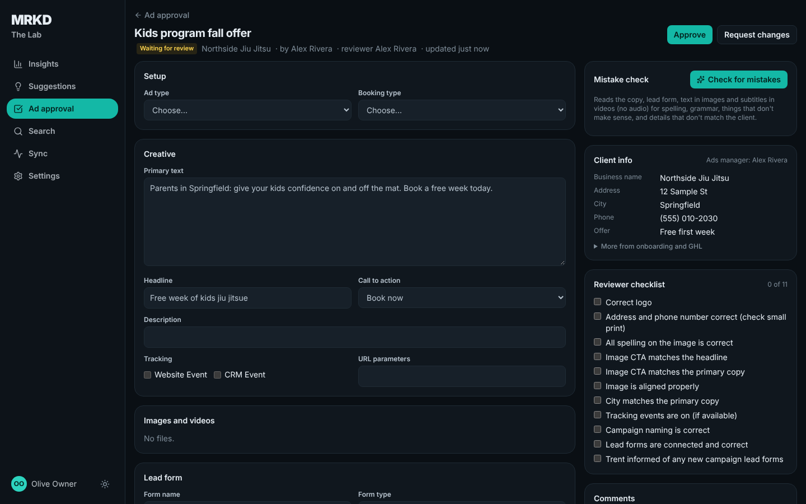
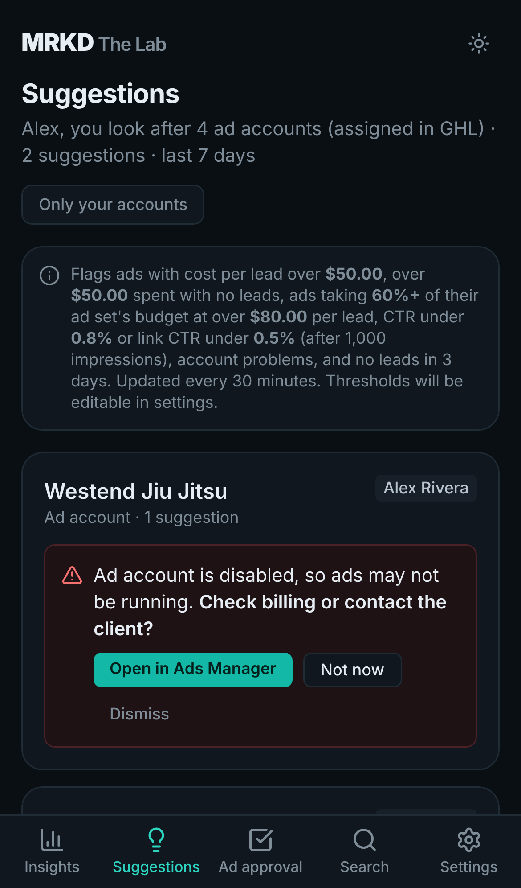

# Design: Air

The Lab has one look, **Air**: light sidebar, lots of white space, teal accent, with a **dark mode**. Picked by Jordan on 11 Nov 2026 from eight options (the decision is in [decisions.md](decisions.md#2026-11-11-look-air-with-light-and-dark-mode)).

## Logo

**The Lab by MRKD.** A teal atom (#14B8A6) on a navy tile (#0F172A) with one white electron: option B of four atom designs, picked by Jordan on 11 Nov 2026. Name: "The Lab", with a smaller "by MRKD" underneath.

| Sidebar, light | Sidebar, dark | Sign-in |
|---|---|---|
|  |  |  |

| Where | File |
|---|---|
| In the app (sidebar, phone header, sign-in) | `web/src/components/LabMark.tsx` (`LabMark`, `LabLockup`); the tile is slightly lighter in dark mode (`--logo-tile` in `index.css`) |
| Browser tab | `web/public/favicon.svg` |
| Logo file to use elsewhere (SVG) | `web/public/brand/the-lab-mark.svg` |
| Phone home screen ("Add to Home Screen") | `web/public/brand/apple-touch-icon.png`, `icon-192.png`, `icon-512.png`, `icon-512-maskable.png`, listed in `web/public/manifest.webmanifest` |

The four options that were considered: [logo-options.png](design/images/logo-options.png). (A plain three-orbit atom on its own looks like the React software logo; the single electron in B makes it distinct.)

## Light and dark

- **Sun / moon button** next to your name in the sidebar (on phones: top right) switches between light and dark.
- **Settings → Light or dark**: Light, Dark, or **Match device** (follows the phone or computer setting). Match device is the default.
- Remembered per browser (`mrkd.mode`).

## Screenshots (sample data)

| Light | Dark |
|---|---|
|  |  |
|  |  |
|  |  |
|  |  |

## Rules

- Simple and organised: plain text labels, no emojis, line icons only in navigation and buttons, consistent spacing.
- Colour means something: the ads-manager name and client status are grey; red and amber are kept for problems, green for good news.
- Desktop: left sidebar. Phones: name and light/dark button at the top, tab bar at the bottom (Insights, Suggestions, Ad approval, Search, Settings; Sync is linked from Settings).

## How it's built

- Every colour, font and corner radius is a named setting ("design token") in [`web/src/index.css`](../web/src/index.css): `surface`, `canvas`, `ink`, `brand`, `primary`, `alert-high`... Components only use those names. The light values are the defaults; dark mode is the `[data-mode="dark"]` block.
- `data-mode` (`light` or `dark`) is set on the page by a small script in [`web/index.html`](../web/index.html) before the page draws, so there's no flash of the wrong mode (including on the sign-in screen), and kept up to date by [`web/src/app/session.tsx`](../web/src/app/session.tsx).
- Font: Inter, bundled with the app (no Google Fonts request, works inside GHL).

## Earlier options (removed 11 Nov 2026)

Classic, Midnight, MRKD Bold, Compact (9 Nov) and Graphite, Onyx, Studio (11 Nov) were removed once Air was picked. Their screenshots and code are in the git history (commit `5be55e5` and before) if one is ever wanted back.
