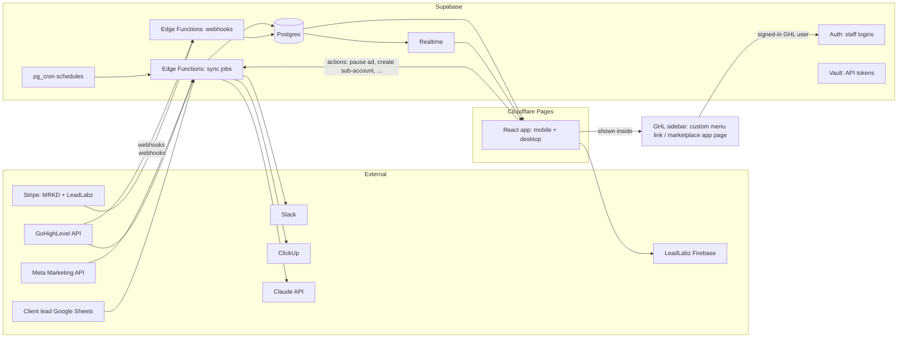
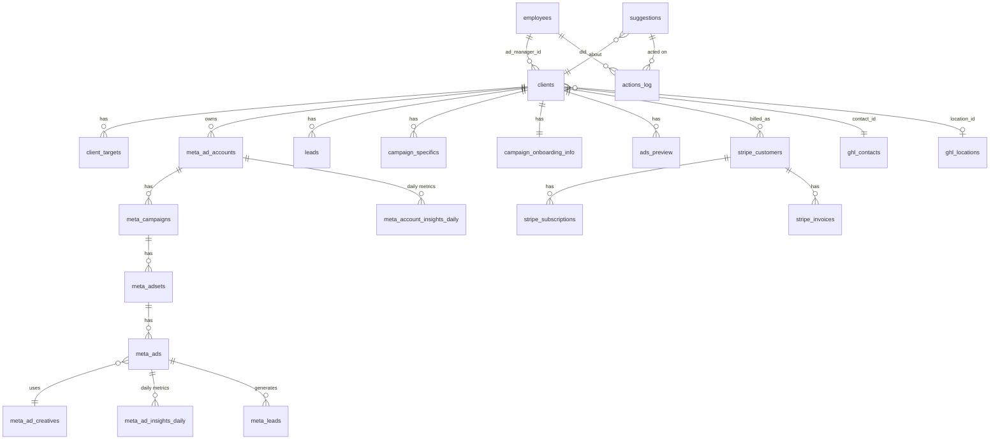

# Plan: replacing Retool with MRKD's own platform

**Status:** draft for review by Jordan and Trent. Nothing is built yet.
**Goal:** one reliable internal platform where ads managers see their clients' performance live on phone or desktop, get suggestions ("ad X has 1 lead at $120, turn it off?") and act on them. It also does everything Retool does today: onboarding, ad approvals, templates, GHL/LeadLabz admin and billing views.

What exists today is documented in [current-system.md](current-system.md).

---

## 1. Principles

1. **Plan the whole thing, build in phases.** The data model below covers every module up front, so later phases add screens, not rewrites.
2. **Sync in the background, read from our database.** Pages never call Meta, GHL or Stripe directly. They are instant and keep working when an external API is down.
3. **Live by default.** The dashboard updates itself when new data lands, with no refresh button.
4. **One app, responsive, inside GHL.** It replaces the Retool dashboard and lives in MRKD's GoHighLevel sidebar, where the team already works. Phone and desktop are the same app with different layouts, and it can be saved to a phone's home screen.
5. **Humans approve actions.** Suggestions never change an ad on their own. Someone clicks, and it's logged.
6. **Documented as we go.** Every phase updates `docs/`.

---

## 2. Architecture

| Piece | Choice | Why |
|---|---|---|
| Database | **Supabase Postgres** | Same engine as Retool Database, so the migration is a straight copy |
| Logins | **GHL single sign-on** inside GHL: the page runs inside MRKD's existing GHL marketplace app, GHL says which user is viewing, and they're matched to `employees.id` (already GHL user IDs). **Google sign-in** is the fallback for the direct link. Both go through Supabase Auth, allowed only for active employees. | No separate login inside GHL. Works on phones through the direct link. |
| Live updates | **Supabase Realtime** | The dashboard updates when a sync finishes |
| Background jobs | **Supabase Edge Functions + pg_cron** | Run every 15–30 min with no extra server. Each sync is independent, so one failure doesn't stall the rest. |
| Secrets | **Supabase Vault** / environment variables | GHL, Meta and Stripe tokens never sit in normal tables again |
| Web app | **React + TypeScript (Vite), hosted on Cloudflare Pages** | Free for business use. All data and live updates come from Supabase, and anything that needs a server runs in Supabase Edge Functions, so the host only serves the pages. |
| Where people open it | **Inside GHL**: a sidebar item, through a custom menu link or a page of MRKD's GHL marketplace app, shown only in MRKD's agency view and own sub-account (never in client sub-accounts). Plus a **direct link** (`app.mrkdmarketing.com`) for phones, since the GHL mobile app doesn't reliably show custom menu items. | Replaces the Retool dashboard where the team already works |
| Meta access | **System User token** from MRKD's Business Manager with `ads_read` + `ads_management` | Doesn't expire like personal tokens. Needed for the "turn it off" buttons. |
| GHL access | Keep MRKD's existing GHL **OAuth app** (agency token plus per-location tokens), refreshed automatically | Already set up and working |
| Stripe | **Webhooks** from both accounts, plus a nightly safety sync | Billing data is instant instead of polled |
| AI | **Claude API** | Ad preview review, creative analysis, plain-English suggestions |

### Cost estimate
| Item | Monthly |
|---|---|
| Supabase Pro (needed: current data has 124k+ insight rows, and Pro adds daily backups) | $25 |
| Cloudflare Pages (hosting) | $0 |
| GHL (already paid; the app is shown inside it) | $0 |
| Claude API for AI review and suggestions | ~$5–20, usage-based |
| **Total** | **~$25–45** |

This replaces Retool (about $30/month) at roughly the same cost.

---

## 3. Modules (feature map)

Each module lists the Retool pieces it replaces.

### M1. Daily dashboard *(replaces Clients View + Meta Ads Insights)*
- Lands on **your clients** (by assigned ads manager). Owners and leads can switch to any manager or "All".
- Per client: status, spend (today / yesterday / 7d / MTD vs budget), leads, cost per lead vs target, booked / shown / closed, new members, MRR generated, ad account health, unread GHL messages, billing status.
- Date presets (today, yesterday, last 7/14/30, this month, last month, custom) with **period-over-period comparison**.
- Drill-down: client → campaigns → ad sets → ads, with **creative thumbnails** and lead stats per ad.
- "Needs attention" pinned to the top (see M2).
- Phone layout: stacked client cards, swipe between managers. Desktop layout: dense sortable table plus a side panel.
- Lead form and ad copy search *(replaces Search Meta Lead Forms)*.

### M2. Suggestions and actions *(new)*
A rules engine runs after every sync and creates **suggestions** for the assigned ads manager:

| Rule (starting set, thresholds editable per client) | Suggested action |
|---|---|
| Ad spent ≥ 3× target CPL with ≤ 1 lead | Pause ad |
| Ad CPL ≥ 2× client target over last 3 days | Pause ad / review creative |
| Active client, 0 leads in last 3 days *(existing alert)* | Check campaign / ad account |
| Ad account disabled, unsettled or has a payment issue | Fix billing / contact client |
| Campaign spending off pace vs monthly budget (over or under) | Adjust budget |
| Frequency > 4 on an ad set | Refresh creative |
| CTR dropped > 40% vs prior 7 days | Refresh creative |
| Unread client messages *(existing alert)* | Reply in GHL |
| Not billed in 14+ days *(existing alert)* | Check Stripe |
| LeadLabz location active, no active subscription *(existing alert)* | Check subscription |

- Each suggestion has **Do it / Snooze / Dismiss**. "Do it" for pause or budget changes calls Meta through the System User token, re-checks the ad's current state first, and logs who did it.
- Suggestions resolve themselves if the condition clears.
- Optional **Slack digest** per ads manager each morning plus urgent pings (account disabled).
- Phase 2+: Claude writes a short plain-English reason and a creative idea for each suggestion.

### M3. Billing *(replaces Stripe parts of Clients View + Stripe Subscriptions Dash)*
- Both Stripe accounts (MRKD Marketing and LeadLabz) via webhooks.
- Per client: LTV, billed in period, active subs, next bill date, paused payments, discounts.

### M4. Leads and outcomes *(replaces Lead Sheet sync workflows)*
- Phase 3: keep syncing from each client's Google Sheet, but every 30 minutes, with per-client error status visible in the app.
- **Decision for later:** move lead tracking (booked / shown / closed / membership) into the app itself so the sheets can be retired.

### M5. Client onboarding *(replaces Clients Onboarding)*
- Same sections: business, gym, instructors, programs, kids, pricing, offers, area callouts with marked-area images, and campaign specifics (ad type, budget plus upper limit, CTA, booking link, lead flow, CRM).
- **Per-client targets** live here: target CPL, monthly budget, upper limit. They feed M2.
- Saves push to the client's GHL contact as today.

### M6. Ad preview and approval *(replaces Ad Preview 🤖 + template apps)*
- Pipeline: Draft → In review → Changes requested → Approved → Launched.
- Build from **ad creative and lead form templates** plus client onboarding data. Upload images.
- Comments thread. Slack notification at each step to the right person. **ClickUp task created through the ClickUp API**, not Zapier.
- **AI review (Claude):** checks copy and image text against the client's business info and flags mistakes.
- Template editor *(replaces Meta Ad Components Templates)*.
- Later: AI ad copy generator *(replaces Ad Ai Analyzer / Ad Copy Generator)*, and creative analysis *(replaces creative_analysis flow)*.

### M7. GHL / LeadLabz admin *(replaces LeadLabz ⚙️, Go High Level, Create Subaccounts workflow)*
- Clients ↔ GHL contact link, client ID assignment.
- **Create sub-account from snapshot** with the same steps as today, plus status and retry.
- Users and permission templates, custom fields and custom values (incl. bulk), custom value mapping.
- Booking calendar embed generator *(replaces Leadlabz calendar embed)*.

### M8. LeadLabz website admin *(replaces Leadlabz (Website) ⚙️)*
- Website users (Firebase), password reset, which businesses and ad accounts they can see, subscription plans, campaign requests.

### M9. Platform
- Staff management (`employees`: role, ads manager flag, Slack ID).
- Sync health page: last run, duration, rows, errors for every job.
- Audit log of every write action.

### Dropped (not rebuilt)
About 25 test, copy and sample apps, AI Chat (use Claude directly), demo workflows. **DELETE CONTACTS** is only rebuilt if needed, with confirmation and an audit log.

---

## 4. Data model

Postgres in Supabase. It keeps most current tables, so migration is a copy, and fixes the problems listed in current-system.md §7.

### Changes from today
| Change | Why |
|---|---|
| `clients.ad_manager_id` → `employees.id`, synced from GHL "Assigned to" | Instant grouping by manager. No decoding on page load. |
| New `client_targets` (target CPL, monthly budget, upper limit, per-rule overrides) | Drives suggestions |
| Real foreign keys across `meta_*` tables and `meta_ad_accounts.client_id` | Correct joins, faster queries |
| `meta_ad_insights_daily` / `meta_account_insights_daily` with **typed columns** (spend, impressions, clicks, reach, frequency, leads, cpl, ctr, cpc), raw JSON kept alongside | Fast reporting |
| New `suggestions` (rule, entity, metrics snapshot, status, assigned_to, resolved_at) | M2 |
| New `actions_log` (who, what, before/after, result) | Audit trail |
| New `sync_runs` replacing `cron_jobs` (job, started, finished, rows, error) | Visibility, retries |
| Tokens move from `ghl_locations.access_token` / `ghl_access_token` into **Vault** | Security |
| `enum_*` tables stay as editable lookup tables | Staff can still add a new ad type |
| Row-level security: staff only, admin-only for GHL/LeadLabz admin and billing | Least privilege |
| Drop leftovers (`ads_preview_copy`, `mobile_app_sample_data`, `gpt_chat_*`, vector table, hard-coded views) | Clean-up |
| All dates stored in UTC, reported in **America/Toronto** through one shared function | Fixes DST drift |

The exact SQL lives in `supabase/migrations/` once Phase 0 starts.

---

## 5. Build phases

Retool keeps running until each phase is verified against it. Cutover is per module, not all at once.

| Phase | What ships | Done when |
|---|---|---|
| **0. Foundations** | Repo scaffold, Supabase project, schema, staff login (GHL sign-on plus Google fallback), Cloudflare Pages deploy, **GHL sidebar item**, docs | Staff open an empty app from the GHL sidebar, already signed in, and from the direct link on a phone |
| **1. Live dashboard** | Meta syncs (independent jobs, every 30 min), clients + ad manager sync from GHL, M1 dashboard on phone and desktop inside GHL, Realtime, sync health page | Numbers match Retool and Meta Ads Manager for a week. **Team uses it daily instead of Clients View / Meta Ads Insights.** |
| **2. Suggestions** | Rules engine, client targets, suggestions inbox, Pause / budget actions with audit log, Slack morning digest | Managers act on suggestions from their phone |
| **3. Billing + leads** | Stripe webhooks (both accounts), lead sheet sync, full Clients View parity (LTV, MRR, booked/shown/closed, unread messages) | Clients View can be retired |
| **4. Operations** | Onboarding, ad preview/approval pipeline, templates, ClickUp API, AI review | Ad Preview and Onboarding retired |
| **5. Admin** | GHL/LeadLabz admin, sub-account creation, users and permissions, custom values, calendar embed, LeadLabz website admin | LeadLabz apps retired |
| **6. Cutover** | Final data copy, turn off Retool workflows, archive Retool export | **Cancel Retool** |

### Data migration
- **Copy the history** from Retool Database: leads, ads_preview, onboarding data, templates, configs and Stripe/Meta history. Retool Database is Postgres, so this is a direct dump-and-restore using the connection string. That needs to be done from someone's computer (or Cowork) because the password must not be pasted into chat.
- **Re-pull from APIs where cleaner.** Meta insights can be re-fetched (Meta keeps up to 37 months), which also fills the new typed columns.

---

## 6. What we need from you

**To start Phase 0 and 1:**
1. Create a **Supabase** account and project (Pro plan) and a free **Cloudflare** account.
2. **Meta System User** in MRKD's Business Manager with `ads_read` + `ads_management`, assigned to all client ad accounts. We'll walk through it.
3. Confirm the app's address, e.g. `app.mrkdmarketing.com`.
4. GHL agency admin access to add the sidebar item and update MRKD's marketplace app (for sign-on). We'll walk through it.

**Questions:**
1. Is GHL's **"Assigned to"** on the client contact still the right source for which manager owns which client?
2. **Target CPL per client:** does it exist anywhere today (GHL custom field, sheet, someone's head)? If not, should we start with one default per ad type (e.g. jiu jitsu kids $X)?
3. **Who logs in?** All employees, or ads managers and owners only? Should anyone see billing besides owners?
4. **Which Retool workflows are actually running today?** The export shows all of them disabled.
5. **Lead tracking:** keep each client's Google Sheet as the source, or move lead outcomes into the app (Phase 3 decision)?
6. **LeadLabz website** (Firebase): staying as is? Is its admin still needed?
7. Screenshots of the two **Retool Forms** that couldn't be exported (*Leadlabz Onboarding form*, *Untitled (1)*).
8. **Google Ads / TikTok:** any client ads outside Meta that should be on the dashboard?
