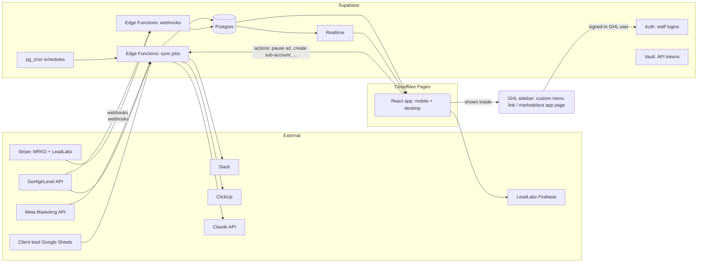
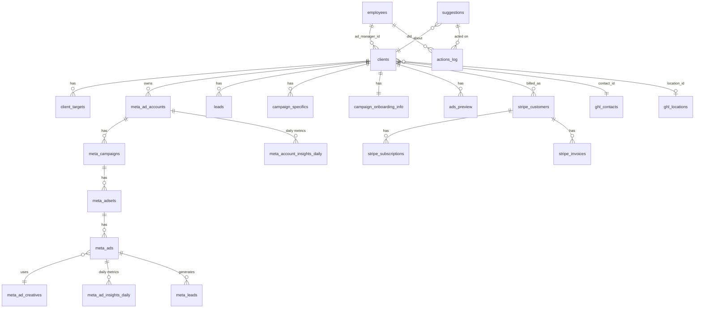

# Plan: replacing Retool with MRKD's own platform

**Status:** agreed Nov 2026. Skeleton built and tested with sample data (see [CHANGELOG.md](../CHANGELOG.md)); waiting on account setup ([setup/accounts.md](setup/accounts.md)).
**Goal:** one reliable internal platform where ads managers see their clients' performance live on phone or desktop, get suggestions ("ad X has 1 lead at $120, turn it off?") and act on them. It also does everything Retool does today: onboarding, ad approvals, templates, GHL/LeadLabz admin and billing views.

What exists today is documented in [current-system.md](current-system.md).

---

## 1. Principles

1. **Plan the whole thing, build in phases.** The data model below covers every module up front, so later phases add screens, not rewrites.
2. **Sync in the background, read from our database.** Pages never call Meta, GHL or Stripe directly. They are instant and keep working when an external API is down.
3. **Live by default.** The dashboard updates itself when new data lands, with no refresh button.
4. **One app, responsive, inside GHL.** It replaces the Retool dashboard and lives in MRKD's GoHighLevel sidebar, where the team already works. Phone and desktop are the same app with different layouts, and it can be saved to a phone's home screen.
5. **Humans approve actions.** Suggestions never change an ad on their own. Someone clicks, and it's logged.
6. **Documented as we go.** Every phase updates `docs/`.

---

## 2. Architecture

| Piece | Choice | Why |
|---|---|---|
| Database | **Supabase Postgres** | Same engine as Retool Database, so the migration is a straight copy |
| Logins | **GHL single sign-on** inside GHL: the page runs inside MRKD's existing GHL marketplace app, GHL says which user is viewing, and they're matched to `employees.id` (already GHL user IDs). **Google sign-in** is the fallback for the direct link. Both go through Supabase Auth, allowed only for active employees. | No separate login inside GHL. Works on phones through the direct link. |
| Live updates | **Supabase Realtime** | The dashboard updates when a sync finishes |
| Background jobs | **Supabase Edge Functions + pg_cron** | Run every 15–30 min with no extra server. Each sync is independent, so one failure doesn't stall the rest. |
| Secrets | **Supabase Vault** / environment variables | GHL, Meta and Stripe tokens never sit in normal tables again |
| Web app | **React + TypeScript (Vite), hosted on Cloudflare Pages** | Free for business use. All data and live updates come from Supabase, and anything that needs a server runs in Supabase Edge Functions, so the host only serves the pages. |
| Where people open it | **Inside GHL**: a sidebar item, through a custom menu link or a page of MRKD's GHL marketplace app, shown only in MRKD's agency view and own sub-account (never in client sub-accounts). Plus a **direct link** (`app.mrkdmarketing.com`) for phones, since the GHL mobile app doesn't reliably show custom menu items. | Replaces the Retool dashboard where the team already works |
| Meta access | **System User token** from MRKD's Business Manager with `ads_read` + `ads_management` | Doesn't expire like personal tokens. Needed for the "turn it off" buttons. |
| GHL access | Keep MRKD's existing GHL **OAuth app** (agency token plus per-location tokens), refreshed automatically | Already set up and working |
| Stripe | **Webhooks** from both accounts, plus a nightly safety sync | Billing data is instant instead of polled |
| AI | **Claude API** | Ad preview review, creative analysis, plain-English suggestions |

### Cost estimate
| Item | Monthly |
|---|---|
| Supabase Pro (needed: current data has 124k+ insight rows, and Pro adds daily backups) | $25 |
| Cloudflare Pages (hosting) | $0 |
| GHL (already paid; the app is shown inside it) | $0 |
| Claude API for AI review and suggestions | ~$5–20, usage-based |
| **Total** | **~$25–45** |

This replaces Retool (about $30/month) at roughly the same cost.

---

## 3. Modules (feature map)

Each module lists the Retool pieces it replaces.

### M1. Daily dashboard *(replaces Clients View + Meta Ads Insights)*
- **Every KPI in Retool's Meta Ads Insights today**, with the same formulas: Active accounts · Leads · CPL · CPM · CR % (leads ÷ link clicks) · CPR (cost per 1,000 reach) · CPLC (cost per link click) · Value generated. Table metrics: spend, impressions, reach, clicks, link clicks, CTR, link CTR, leads, booked / shown / closed, closed value, comments, page likes, messages. Each tile adds a comparison with the previous period.
- Lands on **your clients** (by assigned ads manager). Owners and leads can switch to any manager or "All".
- Per client: status, spend (today / yesterday / 7d / MTD vs budget), leads, cost per lead vs target, booked / shown / closed, new members, MRR generated, ad account health, unread GHL messages, billing status.
- Date presets (today, yesterday, last 7/14/30, this month, last month, custom) with **period-over-period comparison**.
- Drill-down: client → campaigns → ad sets → ads, with **creative thumbnails** and lead stats per ad.
- "Needs attention" pinned to the top (see M2).
- Phone layout: stacked client cards, swipe between managers. Desktop layout: dense sortable table plus a side panel.
- Lead form and ad copy search *(replaces Search Meta Lead Forms)*.

### M2. Suggestions and actions *(new)*
A rules engine runs after every sync and creates **suggestions**, grouped **per ad account**. Each account gets an overview card listing what needs attention, written plainly, for example:

> **Renzo Gracie Boca:** an ad has 1 lead at $120 — turn it off? **[Turn off] [Not now] [Dismiss]**

Suggestions appear **in the app only** (on the account overview and the ads manager's home view). **No Slack.**

Starting rules (agreed with Jordan, Nov 2026). Metrics use the **last 7 days** by default. An ad needs some spend or impressions before it's judged, so new ads aren't flagged too early.

| # | Rule | Default threshold | Suggested action |
|---|---|---|---|
| 1 | **Expensive leads**: ad cost per lead too high | CPL **> $50** (with ≥ 1 lead) | Turn off ad |
| 2 | **Spending with no leads** | Spent **> $50** with 0 leads | Turn off ad |
| 3 | **Budget hog**: one ad takes most of its ad set/campaign's spend while its leads are expensive. Meta often pours most of the weekly budget into 1 of 3 ads, leaving an ad with 1–2 leads at $80–100. | Ad has **≥ 60%** of its ad set's spend **and** either no leads or CPL **> $80** | Turn off that ad so budget moves to the other ads. The card shows the other ads' spend and CPL so the manager can see what they'd be shifting to. |
| 4 | **Low CTR** | CTR **< 0.8%** after ≥ 1,000 impressions | Refresh creative / new hook |
| 5 | **Low link CTR** | Link CTR **< 0.5%** after ≥ 1,000 impressions | Refresh creative / check CTA and offer |
| 6 | Ad account disabled, unsettled or has a payment issue | Any | Fix billing / contact client |
| 7 | Active client with no leads at all in 3 days *(existing Retool alert)* | 0 leads, 3 days | Check campaigns |

- All thresholds are editable in one settings screen, with optional overrides per client or per ad type (a kids program may tolerate a higher CPL than an adult beginners program). The CTR thresholds are starting points to tune after a few weeks of real data.
- Each card links to the ad's creative and metrics so the manager can sanity-check before acting.

- Each suggestion has **Do it / Not now / Dismiss**. "Do it" (e.g. turn off the ad) asks for one confirmation, then calls Meta through the System User token, re-checks the ad's current state first, and logs who did it.
- Suggestions resolve themselves if the condition clears.
- Thresholds have sensible defaults (per ad type) and can be overridden per client.
- Later: Claude adds a short plain-English reason and a creative idea for each suggestion.

### M3. Billing *(replaces Stripe parts of Clients View + Stripe Subscriptions Dash)*
- Both Stripe accounts (MRKD Marketing and LeadLabz) via webhooks.
- Per client: LTV, billed in period, active subs, next bill date, paused payments, discounts.

### M4. Leads and outcomes *(replaces Lead Sheet sync workflows)*
- Phase 3: keep syncing from each client's Google Sheet, but every 30 minutes, with per-client error status visible in the app.
- **Decision for later:** move lead tracking (booked / shown / closed / membership) into the app itself so the sheets can be retired.

### M5. Client onboarding *(replaces Clients Onboarding)*
- Same sections: business, gym, instructors, programs, kids, pricing, offers, area callouts with marked-area images, and campaign specifics (ad type, budget plus upper limit, CTA, booking link, lead flow, CRM).
- **Per-client targets** live here: target CPL, monthly budget, upper limit. They feed M2.
- Saves push to the client's GHL contact as today.

### M6. Ad preview and approval *(replaces Ad Preview + template apps)*
- Pipeline: Draft → In review → Changes requested → Approved → Launched.
- Employees submit **copy + images and/or videos** for approval by **uploading them manually**. "Publish" in this app means *submitting for approval*; the app does not create ads in Meta. Built from **ad creative and lead form templates** plus client onboarding data.
- Comments thread. Slack notification at each step to the right person (as today). **ClickUp task created through the ClickUp API**, not Zapier.

**AI quality check (Claude).** Runs automatically as soon as copy or files are uploaded, so results are ready by the time they submit:

| Asset | What's checked |
|---|---|
| **Copy** (primary text, headline, description, lead form text) | Spelling and grammar. Things that don't make logical sense (e.g. "free trial" in one line, "$49 trial" in another; a date or day that doesn't exist; a broken sentence). Mismatches with the client's details: city, gym name, phone, offer, pricing, program names, booking type. |
| **Images** | Reads all text in the image and checks the same things. Image CTA matches the headline and primary copy. Logo present. Address and phone readable and correct. |
| **Videos** | Reads on-screen text and **burned-in subtitles** from frames across the video and checks spelling and grammar. Frames are extracted in the browser at upload, so no video server is needed. (No audio check; subtitles are checked as text only.) |

Each finding shows where it is (which field, which image, which second of the video), what's wrong and a suggested fix.

**"Hey, just double checking" — a soft warning, not a block.** When someone clicks **Submit for approval** and there are open findings, a prompt lists them: *"Hey, just double checking — we spotted 3 possible issues: …"* with **Fix** (jumps to the spot) or **Submit anyway**. Submitting anyway is allowed and recorded (who, which warnings), so reviewers can see what was knowingly skipped.

- The existing 11-point review checklist (logo, address, spelling, CTA match, city, tracking, naming, lead forms…) stays as tick-boxes for the reviewer. The AI pre-fills what it can check.
- Template editor *(replaces Meta Ad Components Templates)*.
- Later: AI ad copy generator *(replaces Ad Ai Analyzer / Ad Copy Generator)*, and creative analysis *(replaces creative_analysis flow)*.

### M7. GHL / LeadLabz admin *(replaces LeadLabz, Go High Level, Create Subaccounts workflow)*
- Clients ↔ GHL contact link, client ID assignment.
- **Create sub-account from snapshot** with the same steps as today, plus status and retry.
- Users and permission templates, custom fields and custom values (incl. bulk), custom value mapping.
- Booking calendar embed generator *(replaces Leadlabz calendar embed)*.

### M8. LeadLabz website admin *(replaces Leadlabz (Website))*
- Website users (Firebase), password reset, which businesses and ad accounts they can see, subscription plans, campaign requests.

### M9. Platform
- Staff management (`employees`: role, ads manager flag, Slack ID).
- Sync health page: last run, duration, rows, errors for every job.
- Audit log of every write action.

### Dropped (not rebuilt)
About 25 test, copy and sample apps, AI Chat (use Claude directly), demo workflows. **DELETE CONTACTS** is only rebuilt if needed, with confirmation and an audit log.

---

## 4. Data model

Postgres in Supabase. It keeps most current tables, so migration is a copy, and fixes the problems listed in current-system.md §7.

### Changes from today
| Change | Why |
|---|---|
| `clients.ad_manager_id` → `employees.id`, synced from GHL "Assigned to" | Instant grouping by manager. No decoding on page load. |
| New `client_targets` (target CPL, monthly budget, upper limit, per-rule overrides) | Drives suggestions |
| Real foreign keys across `meta_*` tables and `meta_ad_accounts.client_id` | Correct joins, faster queries |
| `meta_ad_insights_daily` / `meta_account_insights_daily` with **typed columns** (spend, impressions, clicks, reach, frequency, leads, cpl, ctr, cpc), raw JSON kept alongside | Fast reporting |
| New `suggestions` (rule, entity, metrics snapshot, status, assigned_to, resolved_at) | M2 |
| New `actions_log` (who, what, before/after, result) | Audit trail |
| New `sync_runs` replacing `cron_jobs` (job, started, finished, rows, error) | Visibility, retries |
| Tokens move from `ghl_locations.access_token` / `ghl_access_token` into **Vault** | Security |
| `enum_*` tables stay as editable lookup tables | Staff can still add a new ad type |
| Row-level security: staff only, admin-only for GHL/LeadLabz admin and billing | Least privilege |
| Drop leftovers (`ads_preview_copy`, `mobile_app_sample_data`, `gpt_chat_*`, vector table, hard-coded views) | Clean-up |
| All dates stored in UTC, reported in **America/Toronto** through one shared function | Fixes DST drift |

The exact SQL lives in `supabase/migrations/` once Phase 0 starts.

---

## 5. Build phases

**Current focus (agreed Nov 2026): replace Meta Ads Insights and the ad approval process (Ad Preview) first.** Clients View, Onboarding and the LeadLabz admin apps **stay in Retool for now** and keep working as they do today. The rest of this plan still describes the full platform so these first pieces fit it, but only Phases 0–2 are scheduled.

| Phase | What ships | Replaces | Done when |
|---|---|---|---|
| **0. Foundations** | Repo scaffold, Supabase project, schema, staff login (GHL sign-on plus Google fallback), Cloudflare Pages deploy, **GHL sidebar item**, **Retool bridge** (see below), docs | – | Staff open an empty app from the GHL sidebar, already signed in, and from the direct link on a phone |
| **1a. Meta insights** | Meta syncs (independent jobs, every 30 min), M1 performance screens on phone and desktop: KPI tiles, accounts / campaigns / ad sets / ads / leads tabs, ads manager filter, date presets with comparison, creatives, CSV export, lead form and ad copy search, sync health page | **Meta Ads Insights**, Search Meta Lead Forms | Numbers match Meta Ads Manager for a week. Team stops opening Meta Ads Insights. |
| **1b. Suggestions** | Rules engine (M2), per-account overview of suggestions in the app (no Slack), default thresholds + per-client overrides, Turn off / budget actions with confirmation and audit log | Retool "alerts" | Managers act on suggestions from their phone |
| **1c. Claude connector** | MRKD connector so employees can ask Claude about their accounts with their own login; same permissions as the app ([claude-connector.md](claude-connector.md)) | – | Every employee can query their accounts from Claude |
| **2. Ad approval** | M6: submission of copy + images/videos, AI quality check (copy, image text, video subtitles), "just double checking" prompt before publishing, review checklist, comments, Slack notifications, ClickUp API, templates, LeadLabz website campaign requests, history copied from Retool | **Ad Preview**, Meta Ad Components Templates | All new ad previews go through the new app |
| *Later* | Billing + leads (Clients View parity), Onboarding, GHL/LeadLabz admin, cutover | Clients View, Clients Onboarding, LeadLabz apps | Decided after Phase 2 |

### Running alongside Retool
While Clients View and Onboarding stay in Retool, some data the new app needs is still **created and kept up to date in Retool**: clients and their ads manager, onboarding info, campaign specifics, lead outcomes from the Google Sheets, employees, and GHL custom-field metadata. Rather than rebuild those syncs now, the new app uses a **Retool bridge**:

- A scheduled job (every 15 min) **reads** those tables from the Retool Database. Retool Database is ordinary Postgres and allows external connections, and the job copies the tables into Supabase. It is read-only and never writes to Retool.
- The connection string is entered **directly into Supabase's secrets by Jordan or Trent**, never pasted in chat.
- **Meta data** is synced by the new app itself from the Meta API, faster and more reliably than Retool's chain. Retool's own Meta syncs keep running for Clients View until it moves.
- **Ad approval data** (previews, templates, comments) moves into the new app fully. The existing 594 previews and all templates are copied over once at the start of Phase 2. After that, Retool's Ad Preview is retired.
- When a later phase moves Clients View or Onboarding, that table's bridge is switched off and the new app becomes its source.

| Data | Source during Phases 0–2 |
|---|---|
| Meta accounts, campaigns, ad sets, ads, creatives, insights, leads, lead forms | **New app** (Meta API) |
| Clients, ads manager mapping, employees | Retool bridge |
| Lead outcomes (booked / shown / closed / value) | Retool bridge |
| Onboarding info, campaign specifics, area callouts | Retool bridge (edited in Retool Onboarding) |
| GHL custom-field metadata (for business info panel and template placeholders) | Retool bridge |
| Ad previews, templates, comments, review checklist | **New app** (history copied once) |
| Suggestions, client targets, audit log | **New app** |

### Data migration
- **Copy the history** from Retool Database: leads, ads_preview, onboarding data, templates, configs and Stripe/Meta history. Retool Database is Postgres, so this is a direct dump-and-restore using the connection string. That needs to be done from someone's computer (or Cowork) because the password must not be pasted into chat.
- **Re-pull from APIs where cleaner.** Meta insights can be re-fetched (Meta keeps up to 37 months), which also fills the new typed columns.

---

## 6. What we need from you

**To start Phase 0 and 1:**
1. Create a **Supabase** account and project (Pro plan) and a free **Cloudflare** account. Add the **Retool Database connection string** to Supabase secrets (we'll show where).
2. **Meta System User** in MRKD's Business Manager with `ads_read` + `ads_management`, assigned to all client ad accounts. We'll walk through it.
3. Confirm the app's address, e.g. `app.mrkdmarketing.com`.
4. GHL agency admin access to add the sidebar item and update MRKD's marketplace app (for sign-on). We'll walk through it.

**Questions:**
1. Is GHL's **"Assigned to"** on the client contact still the right source for which manager owns which client?
2. **Target CPL per client:** does it exist anywhere today (GHL custom field, sheet, someone's head)? If not, should we start with one default per ad type (e.g. jiu jitsu kids $X)?
3. **Who logs in?** All employees, or ads managers and owners only? Should anyone see billing besides owners?
4. **Which Retool workflows are actually running today?** The export shows all of them disabled.
5. **Lead tracking:** keep each client's Google Sheet as the source, or move lead outcomes into the app (Phase 3 decision)?
6. **LeadLabz website** (Firebase): staying as is? Is its admin still needed?
7. Screenshots of the two **Retool Forms** that couldn't be exported (*Leadlabz Onboarding form*, *Untitled (1)*).
8. **Google Ads / TikTok:** any client ads outside Meta that should be on the dashboard?
