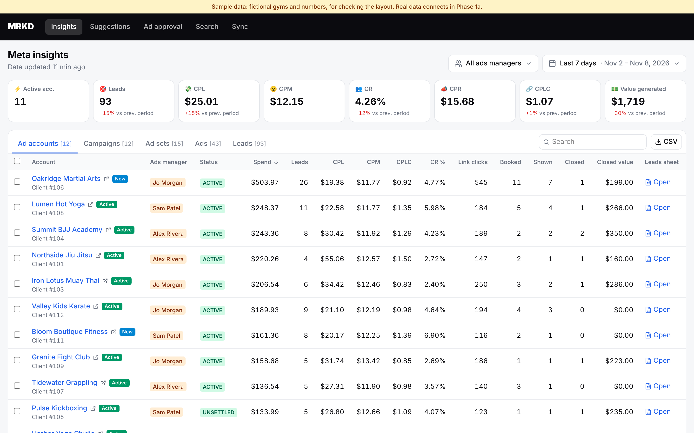
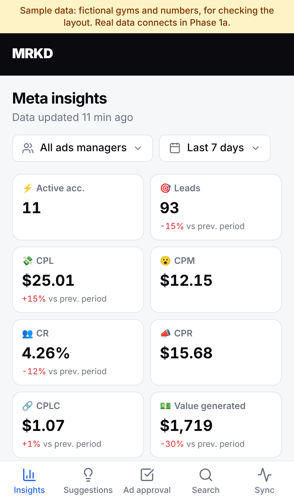
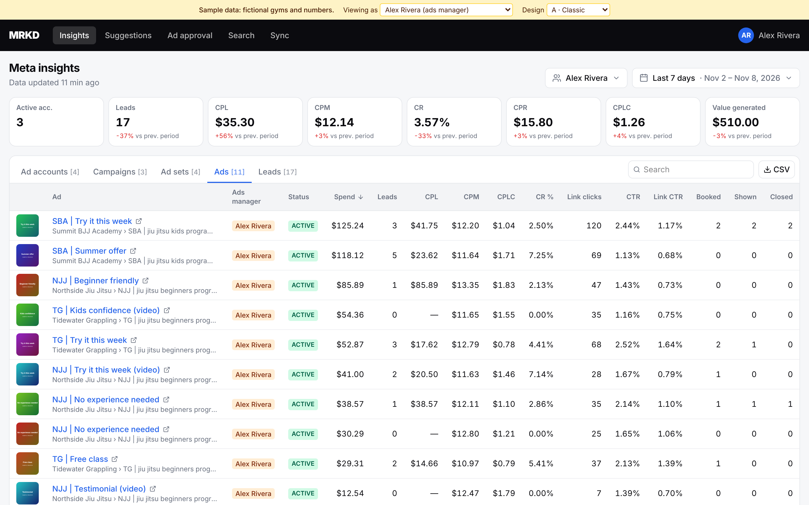
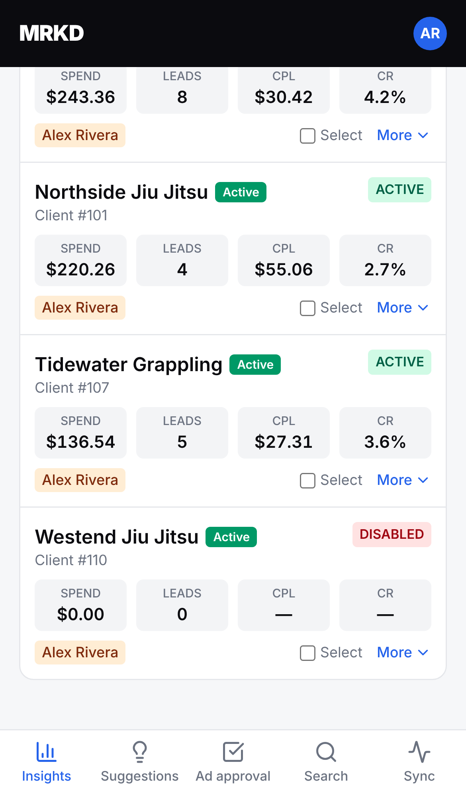
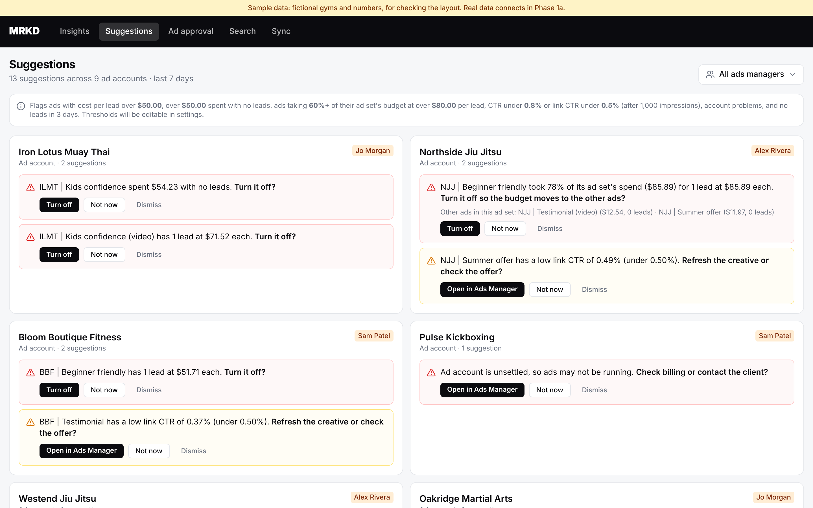
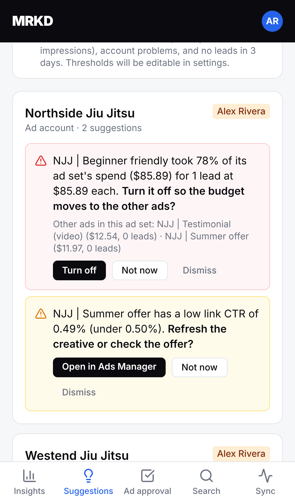

# Screen: Meta insights

Route `/insights`. Code: `web/src/features/insights/`. Replaces Retool's **Meta Ads Insights**. Formulas: [metrics.md](../metrics.md).

## Layout

**Top bar:** ads manager filter (multi-select, empty = everyone; an ads manager's first visit starts on their own GHL-assigned accounts) and date range (presets: Today, Yesterday, This week, Last week, Last 7/14/30 days, This month, Last month, or a custom from/to). "Data updated X min ago" under the title. The chosen preset and managers are remembered on that browser.

**KPI tiles (8):** Active acc. · Leads · CPL · CPM · CR · CPR · CPLC · Value generated. Each shows % change vs the previous period; green = better, red = worse (for costs, down is better).

**Tabs with counts:** Ad accounts · Campaigns · Ad sets · Ads · Leads. Search box (name, account, client, campaign) and **CSV** download of the current tab with the current filters.

## Tables (desktop)

Common to every level: name (links to Ads Manager), parent names, ads manager, status, then
Spend · Leads · CPL · CPM · CPR · CPLC · CR % · Impressions · Reach · Link clicks · Clicks … Booked · Shown · Closed · Closed value.

| Tab | Extra columns |
|---|---|
| Ad accounts | Client status badge, client #, **Leads sheet** link, row checkboxes |
| Campaigns | Daily budget, objective, bid strategy, buying type, pacing |
| Ad sets | Genders, age, optimization goal, ADV+, learning stage |
| Ads | Creative thumbnail (click for the creative popup), CTR, link CTR, comments, page likes, messages |
| Leads | Name, email (mailto), phone, created, form, ad |

Sort with the **Sort** menu above the list (spend, CPL, leads, CR, CPLC, either direction, or name; phone and desktop, remembered per browser) or by clicking a column header. Spend with no leads sorts as the most expensive. Less important columns (CPR, impressions, reach, clicks, settings) appear on wide screens (≥ 1536px) and are always in the CSV and the phone "More" view.

**Selecting accounts** (checkboxes) recalculates the KPI tiles for those accounts (as in Retool) **and** filters the Campaigns, Ad sets, Ads and Leads tabs to them. A chip row shows the selection, with a Clear button.

## Phone

Same filters and tiles (2 per row). Each row becomes a card: name, status, Spend / Leads / CPL / CR, ads manager; **More** expands every metric and an "Open in Ads Manager" link. Bottom tab bar for navigation.

## Creative popup

Image (or video thumbnail and ID), headline, body, CTA, plus spend, leads, CPL, CTR, link CTR, CR for the selected period.

## Search

Route `/search` (`web/src/features/search/`), replacing Retool's **Search Meta Lead Forms**. Toggle **Lead forms / Ad copy** and type: matches form names, pages and questions, or ad names, headlines and body text. Uses safe parameterised search in the database.

## Screenshots (sample data)

| Desktop | Phone |
|---|---|
|  |  |
|  |  |
|  |  |
