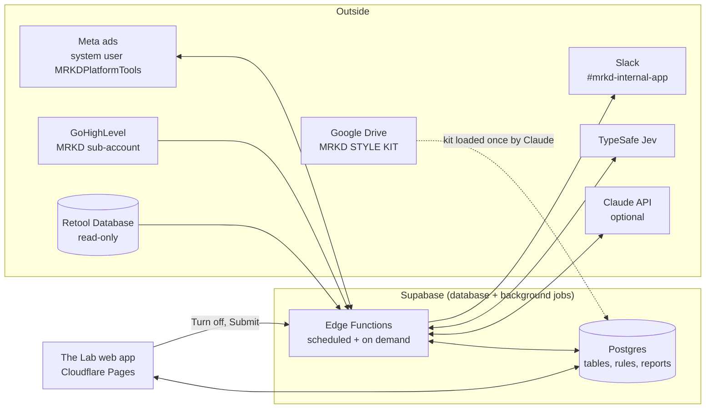

# System map: what's connected to what, and where everything is

One page to find anything in The Lab without digging. Updated 19 Nov 2026. For each piece, the linked doc has the detail.

## The pieces

Nothing in the browser holds a secret: the app only has the public key and the signed-in person's session; the database's row-level security decides what each person sees ([auth.md](auth.md)).

## Services and accounts

| Service | What The Lab uses it for | Where / account | Doc |
|---|---|---|---|
| **Cloudflare Pages** | Hosts the app; rebuilds on every push to `claude/retool-overview-hsg1ch` | Project `sitebuilder`, https://sitebuilder-6iw.pages.dev | [setup/hosting-and-signin.md](setup/hosting-and-signin.md) |
| **GitHub** | All code and these docs | `mrkdmarketing-tech/Sitebuilder`, branch `claude/retool-overview-hsg1ch` | [development.md](development.md) |
| **Supabase** (Pro) | Database, sign-in, background jobs, private file storage | Project `mhayvuxqrlwyvalceerw` (Canada Central) | [setup/accounts.md](setup/accounts.md), [data-model.md](data-model.md) |
| **Meta** | Ad numbers (sync), Turn off / Undo, diagnostics | Business Manager, app **MRKD Platform**, system user **MRKDPlatformTools** | [setup/meta.md](setup/meta.md), [setup/meta-access-checklist.md](setup/meta-access-checklist.md) |
| **GHL** | Clients, status, ads manager, team (read-only, direct since 12 Nov) | MRKD's own sub-account (location `1Pbw0cdWjFMBsIFPrA0d`), private integration "The Lab (read-only)" | [ghl.md](ghl.md) |
| **Retool** | Still the source for clients, onboarding, lead-sheet outcomes, templates; copied every 15 min, never written | Retool Database | [retool-bridge.md](retool-bridge.md) |
| **Slack** | Ad approval messages | #mrkd-internal-app, incoming webhook (not added yet) | [ad-approval.md](ad-approval.md#slack-messages) |
| **TypeSafe (Jev)** | Tags every ad: offer, audience, hook, yes/no tags | console.typesafe.ai | [creative-tags.md](creative-tags.md) |
| **Anthropic (Claude API)** | Optional: reading text inside ad images on Submit | console.anthropic.com (key not added) | [ad-approval.md](ad-approval.md) |
| **Google Drive** | Source of the MRKD ad styles kit (loaded into The Lab per style) | Folder "MRKD STYLE KIT" | [ad-studio.md](ad-studio.md) |
| **jsDelivr CDN** | Serves the browser Python engine (Pyodide 0.27.7) for Ad Studio | Public, no account | [ad-studio.md](ad-studio.md) |
| **Claude Code cloud environment** | Where Claude builds and deploys; holds Claude's Supabase access token | Environment `mrkd-sitebuilder` (network secret for `api.supabase.com`) | [sop/tokens-and-secrets.md](sop/tokens-and-secrets.md#renew-claudes-supabase-access-token) |

## Every secret

All in **Supabase → Edge Functions → Secrets** unless noted. Never in chat, the repo or the browser. Renewal steps: [sop/tokens-and-secrets.md](sop/tokens-and-secrets.md).

| Secret | Used by | Status |
|---|---|---|
| `META_SYSTEM_USER_TOKEN` | meta-sync, meta-action, run-rules, meta-check | Set (never expires) |
| `RETOOL_DB_URL` | retool-bridge | Set |
| `CRON_SECRET` (+ Vault `cron_secret`) | every scheduled job | Set |
| `GHL_PRIVATE_TOKEN` | ghl-sync | Set (12 Nov) |
| `TYPESAFE_API_KEY` | tag-creatives | Set (11 Nov) |
| `SLACK_APPROVALS_WEBHOOK_URL` | approval-notify | **Not set** |
| `ANTHROPIC_API_KEY` | ad-check (Claude part) | **Not set** (optional) |
| Claude's Supabase access token | Claude only (deploys, database) | In the Claude cloud environment; `mrkd-sitebuilder-claude-4` (18 Nov) |

## Background jobs and schedules

| Job | When | Reads → writes |
|---|---|---|
| `retool-bridge` | every 15 min | Retool → clients, employees, onboarding, sheet leads, templates, Ad Preview history |
| `meta-sync` | every 30 min (3 days) + 2:20am (37 days) | Meta → accounts, campaigns, ad sets, ads, creatives, daily insights |
| `run-rules` | :10 and :40 | insights → suggestions (+ Turn off check with Meta) |
| `ghl-sync` | :25 hourly | GHL → `ghl_contacts_live`, `ghl_users_live` (compare only) |
| `tag-creatives` | :50 hourly | creatives → Jev → `creative_tags` |
| `meta-action` | on Turn off / Undo | Meta (pause / resume), `actions_log` |
| `ad-check` | on Submit / Full check | ad copy (+ Claude if key) → findings |
| `approval-notify` | on ad status change | → Slack |
| `meta-check`, `site-check` | on demand (Claude) | diagnostics only |

Detail and how to check them: [background-jobs.md](background-jobs.md). Every run is listed on the **Sync** screen.

## Where each kind of data comes from

| Data | Source today | Notes |
|---|---|---|
| Spend, leads, clicks, statuses of ads | Meta (meta-sync) | Lead **counts** only: names and contact details are not read (decided 12 Nov) |
| Clients, status, ads manager | GHL via Retool copy; direct GHL read running alongside | Changes made in The Lab win (`client_overrides`) and aren't sent to GHL yet |
| Staff list and roles | GHL users via Retool copy; roles set in The Lab | Owners: Jordan, Trent ([sop/staff-and-access.md](sop/staff-and-access.md)) |
| Booked / showed / closed per lead | Client Google Sheets via Retool (`sheet_leads`) | Not used on screens yet |
| Onboarding, offers, programs | Retool onboarding | Used by ad approval checks and Ad Studio |
| Ad tags | Jev | [creative-tags.md](creative-tags.md) |
| Ads in approval, comments, checklist | The Lab | Old Retool Ad Preview history copied in, read-only |
| Ad styles kit | Google Drive → `style_kit_files` | Loaded per style by Claude ([ad-studio.md](ad-studio.md)) |
| Client websites (SEO) | Public websites (site-check) | [seo.md](seo.md) |

## Screens and where their code is

| Screen | Code | How-to |
|---|---|---|
| Today (home) | `web/src/features/today/` | [sop/acting-on-suggestions.md](sop/acting-on-suggestions.md) |
| Insights (+ What's working, Active CPL, tags) | `web/src/features/insights/` | [sop/daily-account-check.md](sop/daily-account-check.md), [screens/insights.md](screens/insights.md) |
| Ad approval (+ Ad Studio) | `web/src/features/approvals/`, `web/src/features/studio/` | [sop/ad-approval-submit.md](sop/ad-approval-submit.md), [sop/ad-approval-review.md](sop/ad-approval-review.md), [sop/ad-studio.md](sop/ad-studio.md) |
| Search (ad copy) | `web/src/features/search/` | [screens/insights.md](screens/insights.md#search) |
| Clients | `web/src/features/clients/` | [sop/new-client-or-ad-account.md](sop/new-client-or-ad-account.md) |
| Sync | `web/src/features/status/` | [sop/weekly-health-check.md](sop/weekly-health-check.md) |
| Settings (staff, thresholds, two-step) | `web/src/features/settings/` | [sop/staff-and-access.md](sop/staff-and-access.md), [sop/changing-thresholds.md](sop/changing-thresholds.md), [sop/security.md](sop/security.md) |

Rules shared by the app and the jobs live in `shared/domain/` (one file per topic, each with tests): metrics, dates, rules (suggestions), today, approvals, adChecks (mistake checks), approvalSlack, creativeTags, styleKit (Ad Studio), metaErrors, ghl, siteCheck.

## What's waiting on someone

The live list of open items is in [open-items.md](open-items.md).
